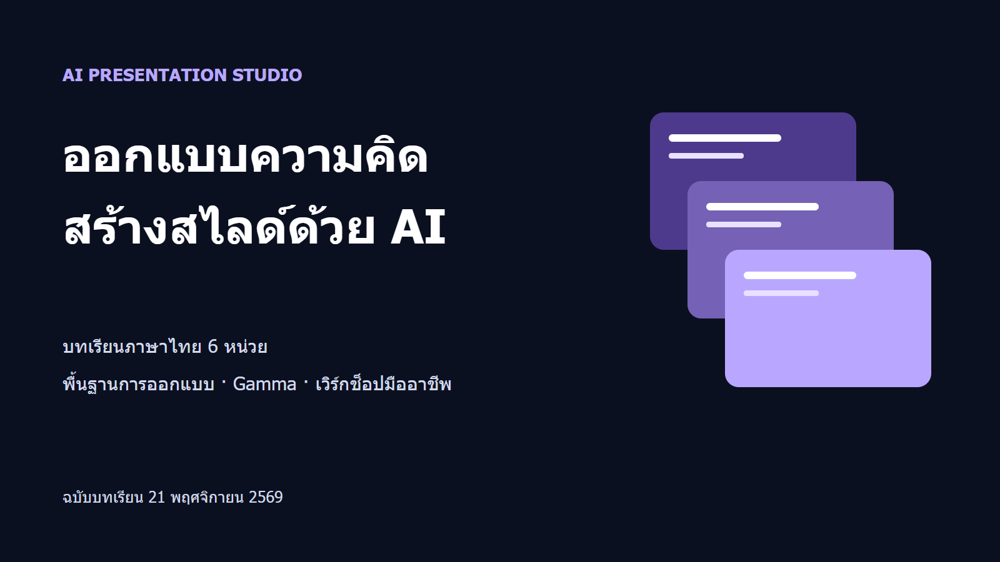

# AI Presentation Studio

### ออกแบบความคิด สร้างสไลด์ และนำเสนออย่างมืออาชีพด้วย AI



หลักสูตรภาษาไทยสำหรับผู้เริ่มต้น ใช้ **Gamma** เป็นเครื่องมือหลัก เรียนตั้งแต่เลือกสี วางเรื่อง สั่ง AI ไปจนถึงตรวจแก้และนำเสนอจริง

**วันที่ฉบับบทเรียน: 21 พฤศจิกายน 2569 (2026)** ตามโจทย์ · **วันที่ตรวจข้อมูลออนไลน์: 27 พฤศจิกายน 2569** วันตรวจข้อมูลเป็นคนละวันกับวันที่ฉบับบทเรียน ราคา โควตา และเมนูอาจเปลี่ยน ให้ตรวจลิงก์ทางการก่อนเริ่มสอน

## เริ่มเรียน

| หน่วย | เรื่อง | ผลงาน | สถานะ |
| --- | --- | --- | --- |
| [01](units/01-design-foundations.md) | พื้นฐานการออกแบบและเลือกเครื่องมือนำเสนอ | โจทย์ ระบบสี และสตอรีบอร์ด | ฉบับเต็ม |
| [02](units/02-gamma-thai.md) | สร้างสไลด์ภาษาไทยด้วย Gamma | สไลด์ 5 หน้าและบันทึกการแก้ AI | ฉบับเต็ม |
| [03](units/03-professional-workshops.md) | เวิร์กช็อปงานนำเสนอระดับมืออาชีพ | 3 รูปแบบ รูปแบบละ 5 หน้า | ฉบับเต็ม |
| [04](units/04-data-storytelling.md) | การเล่าเรื่องด้วยข้อมูลและการออกแบบกราฟ | สไลด์ข้อมูลและข้อเสนอ | ฉบับเต็ม |
| [05](units/05-media-and-delivery.md) | สื่อประกอบ การเคลื่อนไหว และทักษะการนำเสนอ | สไลด์พร้อมซ้อมพูดและไฟล์สำรอง | ฉบับเต็ม |
| [06](units/06-capstone.md) | โครงงานนำเสนอด้วย AI และแฟ้มสะสมผลงาน | โครงงานและแฟ้มสะสมผลงาน | กำลังขยายเป็นฉบับเต็ม |

**เส้นทางแนะนำ:** หน่วย 1 → หน่วย 2 → เลือกเวิร์กช็อปหน่วย 3 → ส่งงานและสะท้อนการใช้ AI

## วิธีใช้

1. คลิกชื่อหน่วยเพื่ออ่านบน GitHub ภาพประกอบเก็บในคลังนี้
2. เตรียมคอมพิวเตอร์ อินเทอร์เน็ต และบัญชี Gamma Free กิจกรรมหลักไม่กำหนดให้ซื้อแผน
3. ทำใบงานและแก้ข้อความคำสั่งให้ตรงกับโจทย์ของตนก่อนสร้าง
4. ดู [คลังตัวอย่างสไลด์](examples/README.md) เพื่อทำตาม ภาพเป็นต้นแบบที่ผู้จัดทำออกแบบ ไม่ใช่ภาพหน้าจอจาก Gamma
5. ตรวจตาม [เกณฑ์ประเมิน](worksheets/assessment.md) แล้วใช้ [แบบส่งงาน](worksheets/submission-template.md)

## สำหรับผู้สอน

ออกแบบสำหรับมัธยมปลาย อาชีวศึกษา และบุคคลทั่วไปที่พิมพ์ไทยและใช้เว็บได้ ปรับความยากตามกลุ่มจริงได้ เวลาแนะนำหน่วย 1 จำนวน 3 ชั่วโมง หน่วย 2 จำนวน 3 ชั่วโมง และหน่วย 3 จำนวน 6 ชั่วโมง หน่วย 4–6 ยังไม่มีเนื้อหาหรือกำหนดเวลา

- [แนวทางจัดกิจกรรม](TEACHING-GUIDE.md)
- [ใบงาน 1: ออกแบบโจทย์](worksheets/01-design-brief.md)
- [ใบงาน 2: ทดลอง Gamma](worksheets/02-gamma-lab.md)
- [ใบงาน 3: เวิร์กช็อป](worksheets/03-workshop.md)
- [แหล่งอ้างอิง](SOURCES.md) และ [เครดิตภาพ](ASSET-CREDITS.md)

```text
units/           บทเรียนหน่วย 1–3 และหัวข้อหน่วย 4–6
worksheets/      ใบงาน เกณฑ์ประเมิน และแบบส่งงาน
examples/        ภาพตัวอย่างและข้อความนำเข้า Gamma
assets/photos/   ภาพถ่ายที่ดาวน์โหลด
assets/diagrams/ ภาพอธิบายที่ออกแบบสำหรับหลักสูตร
scripts/         สคริปต์สร้างภาพและตรวจไฟล์
```

ไฟล์ใช้ UTF-8 อ่านบน GitHub ได้ทันที SVG เป็นภาพต้นฉบับที่แก้ได้ PNG ใช้แสดงผลคงที่ ตัวอย่างภาพไม่ใช่ไฟล์ PowerPoint ให้สร้างองค์ประกอบใหม่ใน Gamma ตามบทเรียน ตัวเลขตัวอย่างเป็นข้อมูลสมมติเพื่อฝึกออกแบบ

เนื้อหาและกราฟิกที่จัดทำใหม่ใช้ [MIT License](LICENSE) ภาพภายนอกใช้สิทธิ์ตาม [เครดิตภาพ](ASSET-CREDITS.md)
