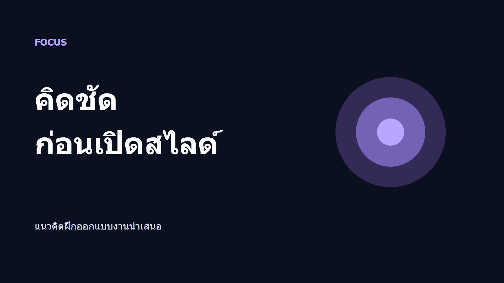
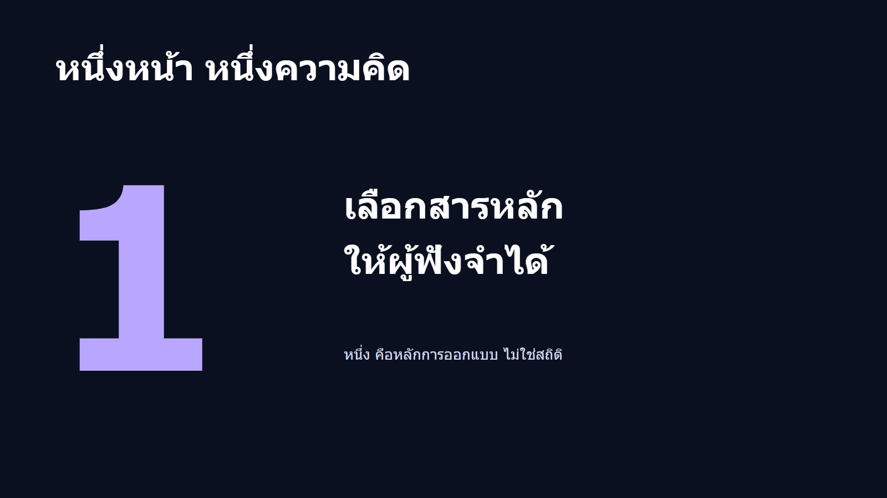
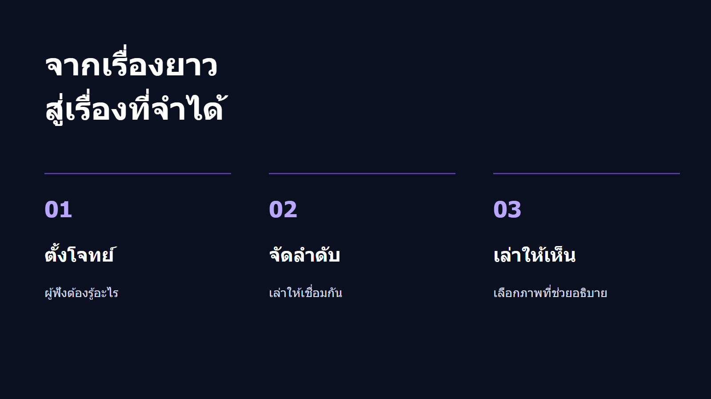
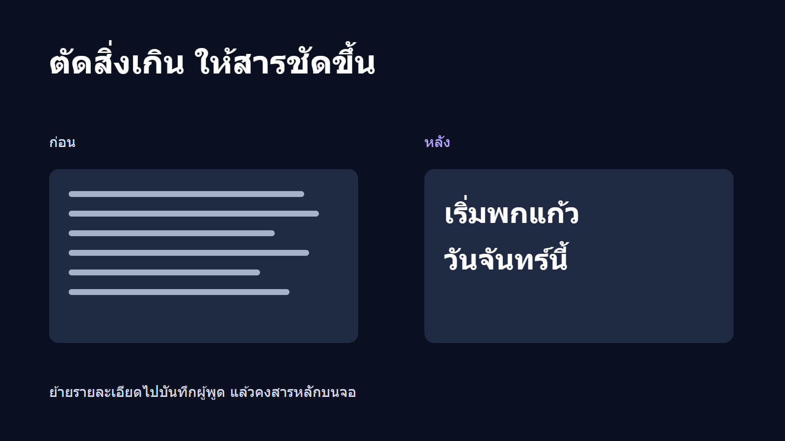
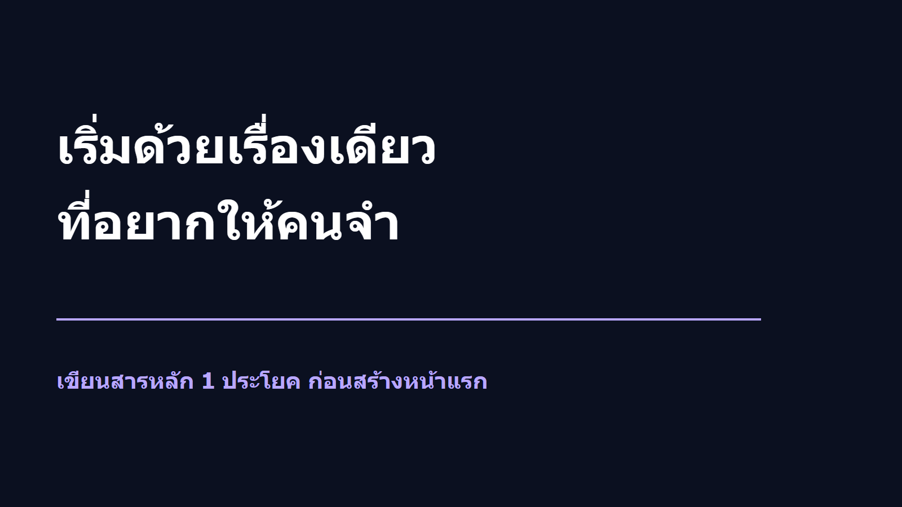

# ตัวอย่าง A · มินิมอลสำหรับเปิดตัวความคิด

ประยุกต์หลักพื้นที่ว่างและหนึ่งประเด็นต่อหน้า ไม่มีการคัดลอกสไลด์ โลโก้ หรือผลิตภัณฑ์ Apple ชื่อ FOCUS เป็นแนวคิดสมมติเพื่อฝึก

[วิธีทำทีละหน้า](../../units/03-professional-workshops.md) · [ข้อความนำเข้า](../prompts/minimal-keynote.txt) · [คลังตัวอย่าง](../README.md)

## 1. คิดชัดก่อนเปิดสไลด์

[ต้นฉบับ SVG](slide-01.svg)

## 2. หนึ่งหน้า หนึ่งความคิด

[ต้นฉบับ SVG](slide-02.svg)

## 3. จากเรื่องยาว สู่เรื่องที่จำได้

[ต้นฉบับ SVG](slide-03.svg)

## 4. ตัดสิ่งเกิน ให้สารชัดขึ้น

[ต้นฉบับ SVG](slide-04.svg)

## 5. เริ่มด้วยเรื่องเดียวที่อยากให้คนจำ

[ต้นฉบับ SVG](slide-05.svg)
