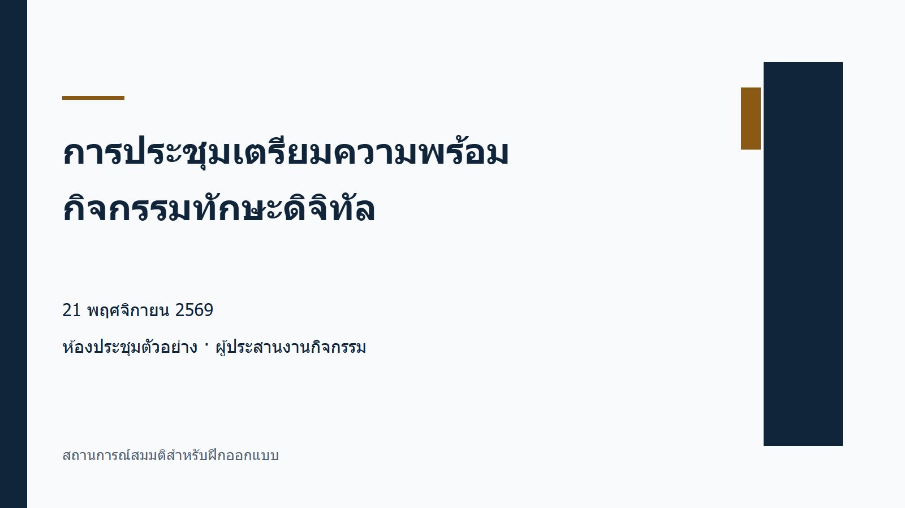
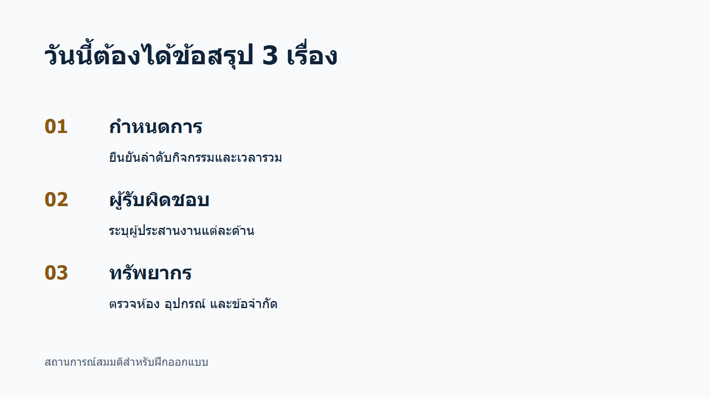
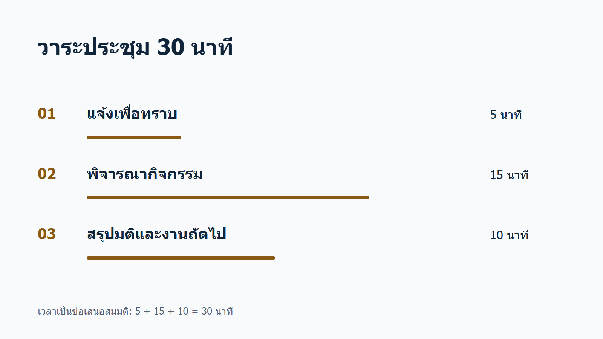
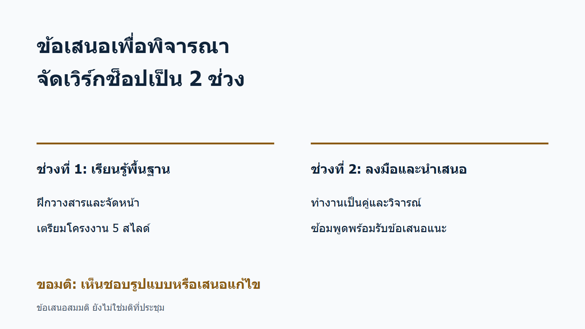
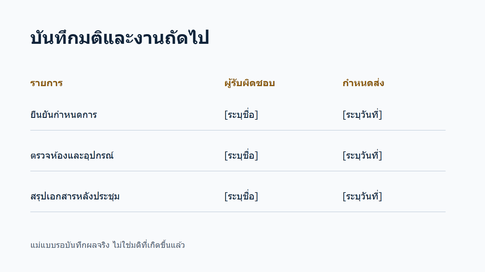

# ตัวอย่าง B · ประชุมอย่างเป็นทางการ

สถานการณ์สมมติ ไม่มีตราหน่วยงานหรือมติจริง วันที่ 21 พฤศจิกายน 2569 เป็นวันที่ตัวอย่างตามโจทย์หลักสูตร

[วิธีทำทีละหน้า](../../units/03-professional-workshops.md) · [ข้อความนำเข้า](../prompts/formal-meeting.txt) · [คลังตัวอย่าง](../README.md)

## 1. เปิดประชุม

[ต้นฉบับ SVG](slide-01.svg)

## 2. ผลลัพธ์ที่ต้องได้

[ต้นฉบับ SVG](slide-02.svg)

## 3. วาระ 30 นาที

[ต้นฉบับ SVG](slide-03.svg)

## 4. ข้อเสนอเพื่อพิจารณา

[ต้นฉบับ SVG](slide-04.svg)

## 5. แม่แบบบันทึกผล

[ต้นฉบับ SVG](slide-05.svg)
