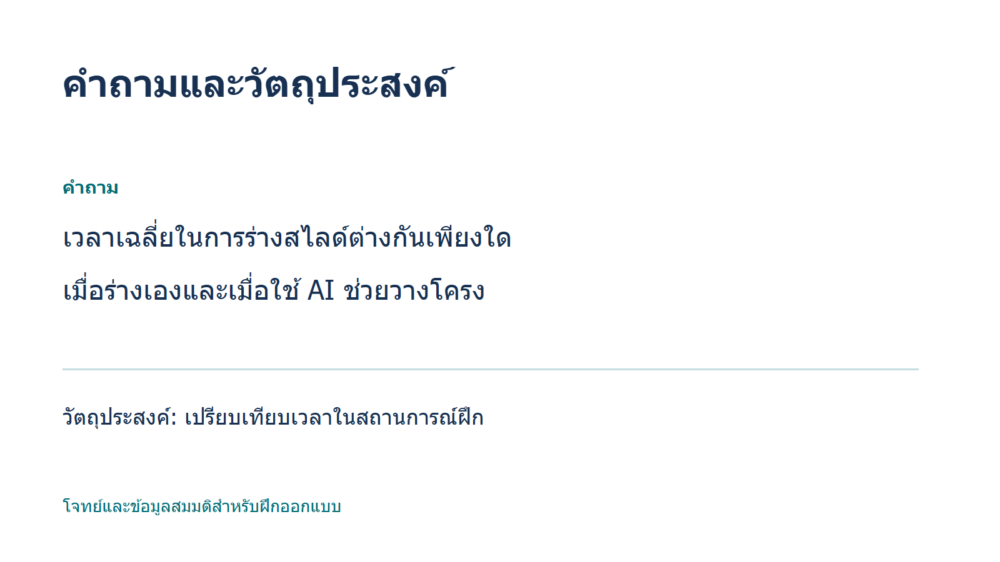
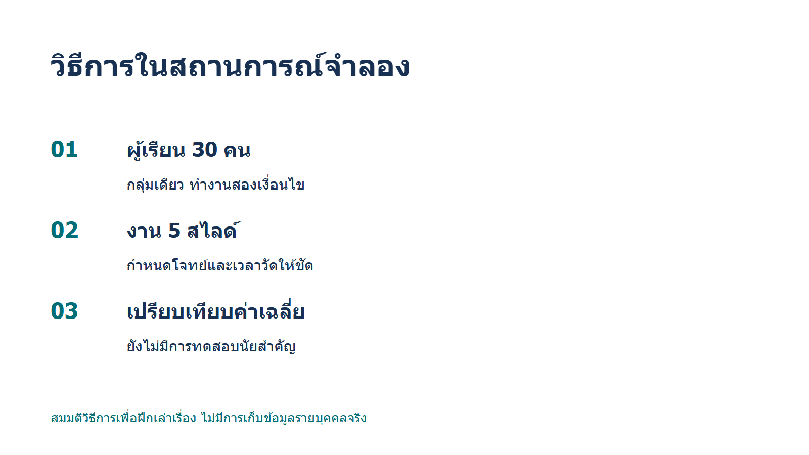
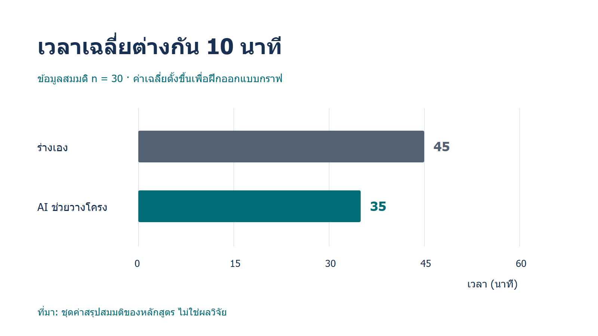
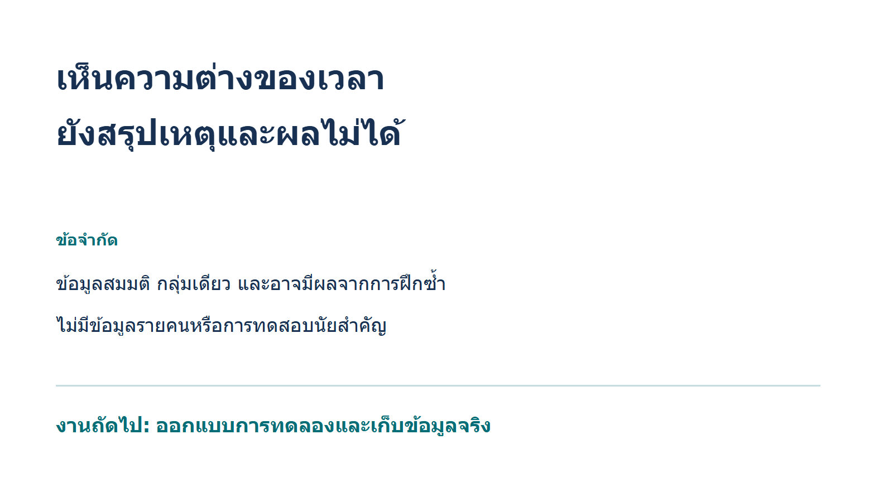

# ตัวอย่าง C · งานนำเสนอเชิงวิชาการ

ข้อมูลทั้งหมดสมมติเพื่อฝึกออกแบบ **ไม่มีการเก็บข้อมูลรายคนหรือทำวิจัยจริง** ค่าเฉลี่ย 45/35 นาทีและกลุ่มสมมติ 30 คนใช้ฝึกกราฟเชิงพรรณนา ห้ามอ้างนัยสำคัญ เหตุและผล หรือประสิทธิผลทั่วไปจากตัวอย่างนี้

[วิธีทำทีละหน้า](../../units/03-professional-workshops.md) · [ข้อความนำเข้า](../prompts/academic.txt) · [ค่าสรุปสมมติ CSV](simulated-summary.csv) · [คลังตัวอย่าง](../README.md)

## 1. ชื่อเรื่อง

[ต้นฉบับ SVG](slide-01.svg)

## 2. คำถามและวัตถุประสงค์

[ต้นฉบับ SVG](slide-02.svg)

## 3. วิธีการจำลอง

[ต้นฉบับ SVG](slide-03.svg)

## 4. ผลเชิงพรรณนาจากค่าสมมติ

[ต้นฉบับ SVG](slide-04.svg)

## 5. ข้อจำกัดและการศึกษาเพิ่มเติม

[ต้นฉบับ SVG](slide-05.svg)
