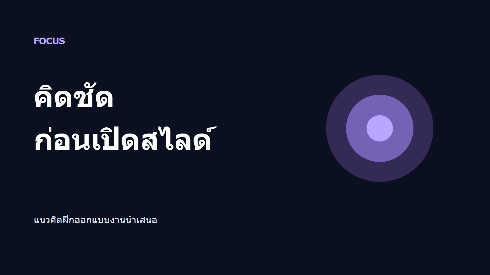
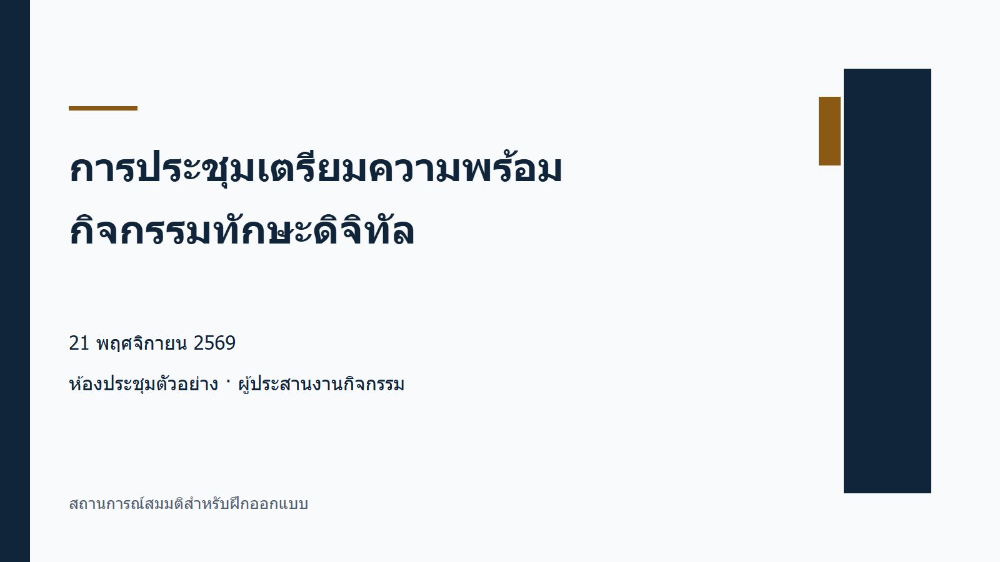
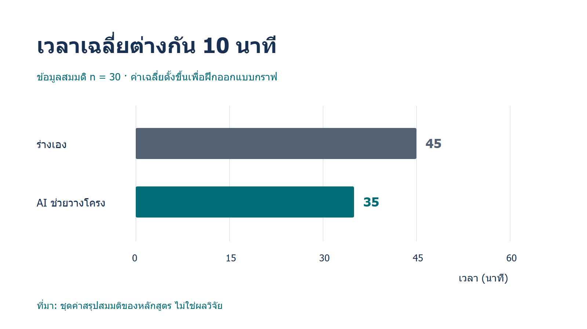

# คลังตัวอย่างสไลด์

ต้นแบบภาษาไทย 3 ชุด ชุดละ 5 หน้า รวม 15 หน้า อ่านภาพได้บน GitHub และใช้ข้อความนำเข้า Gamma ตาม [หน่วย 3](../units/03-professional-workshops.md)

| ชุด | เป้าหมาย | ข้อความสำหรับนำเข้า |
| --- | --- | --- |
| [มินิมอลประยุกต์หลักการสไลด์ Apple](01-minimal-keynote/README.md) | เปิดตัวแนวคิด เน้นสารและพื้นที่ว่าง | [5 หน้า](prompts/minimal-keynote.txt) |
| [ประชุมทางการ](02-formal-meeting/README.md) | เปิดประชุม วาระ ข้อเสนอ และติดตามงาน | [5 หน้า](prompts/formal-meeting.txt) |
| [วิชาการ](03-academic/README.md) | คำถาม วิธีการ ผล และข้อจำกัด | [5 หน้า](prompts/academic.txt) |

PNG คือภาพตัวอย่าง SVG คือต้นฉบับกราฟิกที่แก้ได้ ไม่ใช่ PPTX และไม่ใช่ไฟล์ที่สร้างจาก Gamma หากนำ PNG ไปใส่สไลด์จะเป็นภาพเดียว ให้ใช้ไฟล์ข้อความแล้วสร้างองค์ประกอบใหม่เพื่อแก้ข้อความได้ใน Gamma รูปแบบจริงอาจต่างจากภาพต้นแบบ

วิธีดาวน์โหลด: เปิดไฟล์ที่ต้องการบน GitHub แล้วเลือก Download raw file หรือเปิด Raw ตามชนิดไฟล์ ข้อความคั่นด้วย `---` หนึ่งส่วนต่อหนึ่งหน้า ดู [เครดิตภาพ](../ASSET-CREDITS.md)

[หน้าหลัก](../README.md)
