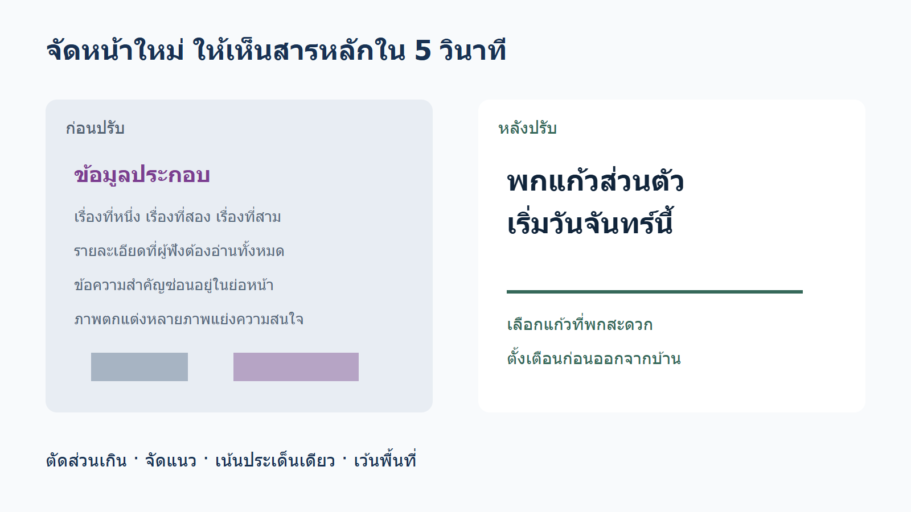
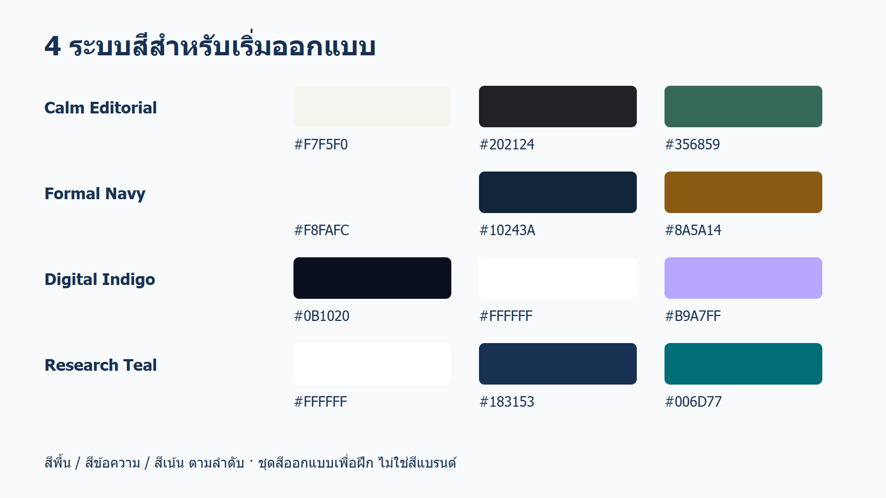
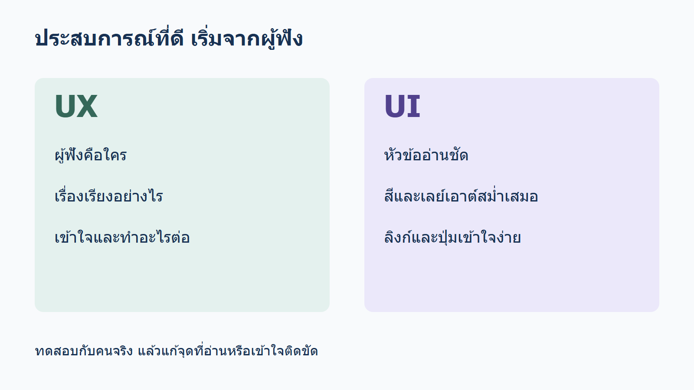

# หน่วยที่ 1 · พื้นฐานการออกแบบและเลือกเครื่องมือนำเสนอ

[หน้าหลัก](../README.md) · [หน่วยถัดไป](02-gamma-thai.md)

เวลาแนะนำ 3 ชั่วโมง · ฉบับ 21 พฤศจิกายน 2569 · ตรวจข้อมูลเครื่องมือ 27 พฤศจิกายน 2569

## เป้าหมาย

วิเคราะห์ผู้ฟังและเป้าหมาย เขียนสารหลัก เลือกสีและฟอนต์ที่อ่านง่าย วางองค์ประกอบด้วยหลัก UX/UI และเลือกเครื่องมือ AI อย่างมีเหตุผล ผลงานคือ [ใบงานออกแบบ](../worksheets/01-design-brief.md) 1 ชุด

## 1.1 เริ่มจากสารและผู้ฟัง

งานนำเสนอเรียงข้อมูลให้ผู้ฟังเข้าใจเรื่องและตัดสินใจหรือทำบางอย่างต่อ สไลด์ช่วยให้เห็นประเด็น ผู้พูดอธิบายความเชื่อมโยง เอกสารประกอบเก็บรายละเอียดที่ไม่ควรอัดลงจอ

| คำถามก่อนเปิดโปรแกรม | ตัวอย่างงานรณรงค์ในโรงเรียน |
| --- | --- |
| ผู้ฟังคือใคร รู้อะไรอยู่แล้ว | นักเรียนที่ใช้แก้วพลาสติกทุกวัน ยังไม่เห็นทางเลือกที่สะดวก |
| จบแล้วอยากให้ทำอะไร | นำแก้วส่วนตัวมาทดลองใช้ 1 สัปดาห์ |
| อยากให้จำอะไร 1 ประโยค | การพกแก้วเป็นกิจวัตรเล็ก ๆ ที่เริ่มร่วมกันได้ |
| เวลาและหลักฐานมีอะไร | พูด 3 นาที มีภาพกิจกรรมและข้อมูลนับแก้วที่เก็บเอง |

เขียนชื่อสไลด์เป็นประโยคที่มีสาร เช่น “เริ่มพกแก้วในวันจันทร์นี้” แทน “สรุป” เพื่อให้ผู้ฟังรู้ประเด็นทันที โครงเรื่องเริ่มต้น 5 หน้า คือ เปิดประเด็น → ปัญหา → แนวทาง → หลักฐาน → สิ่งที่ให้ทำต่อ งานวิชาการปรับเป็น คำถามวิจัย → วัตถุประสงค์ → วิธีการ → ผล → ข้อสรุปและข้อจำกัด

## 1.2 เตรียมอะไรให้ AI

- โจทย์ ผู้ฟัง เวลาพูด และจำนวนหน้า เช่น 5 หน้าใน 3 นาที
- ข้อมูลที่ตรวจแล้วพร้อมที่มา วันที่ และหน่วย ระบุข้อมูลสมมติให้ชัด
- ระบบภาพ ได้แก่ สีพื้น สีข้อความ สีเน้น ฟอนต์ และตัวอย่างการวางหน้า
- ภาพที่สื่อความหมาย มีสิทธิ์ใช้ และคำอธิบายสำหรับคนที่มองภาพไม่ชัด
- ช่องทางใช้จริง ได้แก่ ฉายจอ อ่านบนมือถือ หรือพิมพ์แจก เพราะความหนาแน่นข้อความควรต่างกัน

AI ช่วยร่างเรื่อง ย่อข้อความ และเสนอการจัดหน้า ผู้สร้างยังต้องตรวจข้อเท็จจริง ความหมาย สิทธิ์ภาพ และความเหมาะสมกับผู้ฟัง

## 1.3 หลักจัดองค์ประกอบ

| หลักการ | วิธีใช้ | วิธีตรวจ |
| --- | --- | --- |
| ลำดับความสำคัญ (Hierarchy) | หัวข้อเด่น หลักฐานรอง ที่มาน้ำหนักน้อยกว่า | มอง 5 วินาทีแล้วบอกสารได้หรือไม่ |
| การจัดแนว (Alignment) | ยึดเส้นซ้ายหรือกริดเดียวกัน | แนวหัวข้อ เนื้อหา และภาพสัมพันธ์กันหรือไม่ |
| ความใกล้กัน (Proximity) | วางคำอธิบายติดสิ่งที่กล่าวถึง | มีคำที่ดูเหมือนอธิบายผิดภาพหรือไม่ |
| ความแตกต่าง (Contrast) | เน้นด้วยขนาด น้ำหนัก และสี | ขาวดำแล้วยังแยกความสำคัญได้หรือไม่ |
| ความสม่ำเสมอ (Consistency) | ใช้หัวข้อและสีเน้นระบบเดียวกัน | หน้าใดหลุดจากภาพรวมของชุดหรือไม่ |
| พื้นที่ว่าง (White space) | เว้นพื้นที่รอบข้อความและภาพ | ต้องลดตัวอักษรเพราะยัดข้อมูลหรือไม่ |

**ค่าตั้งต้นสำหรับฝึก:** สัดส่วน 16:9 หัวข้อราว 32–44 pt เนื้อหา 24–28 pt ในโปรแกรมที่กำหนดหน่วย pt เว้นขอบประมาณ 5–7% ค่านี้เป็นแนวทางของหลักสูตร ต้องลองฉายจากท้ายห้องจริง Gamma อาจแสดงระดับข้อความแทนหน่วย pt

ภาษาไทยมีสระและวรรณยุกต์เหนือ–ใต้บรรทัด เริ่มระยะบรรทัดราว 1.3–1.5 เท่าแล้วตรวจกรอบข้อความ อย่าให้สระถูกตัด ใช้หนึ่งตระกูลฟอนต์ แยกหัวข้อกับเนื้อหาด้วยขนาดและน้ำหนักก่อนเพิ่มฟอนต์ใหม่

ตัวเลือกสำหรับทดลอง ได้แก่ **Sarabun, Noto Sans Thai และ Prompt** จาก [Google Fonts](https://fonts.google.com/?subset=thai) แต่ต้องตรวจว่าเครื่องมือและบัญชีมีฟอนต์นั้นหรือไม่ หากไม่มีให้ใช้ฟอนต์ไทยที่ระบบมีและอ่านได้ครบ การติดตั้งในคอมพิวเตอร์ไม่ได้ทำให้ใช้บน Gamma ได้ทันที

## 1.4 เลือกสีตามหน้าที่

Hue คือกลุ่มสี Saturation คือความสด Lightness คือความสว่าง ใช้ทั้งสามอย่างสร้างความแตกต่าง เริ่มด้วยสีพื้น 1 สี สีข้อความ 1 สี และสีเน้น 1 สี เพิ่มสีรองเมื่อมีหน้าที่ชัดเจน แนวคิดสัดส่วน 60–30–10 ใช้ทดลองแบ่งพื้นที่ได้ แต่ไม่ใช่มาตรฐานที่ทุกหน้าต้องทำตาม

| ชุดสีที่หลักสูตรออกแบบ | พื้น | ข้อความ | สีเน้น | เหมาะกับ |
| --- | --- | --- | --- | --- |
| Calm Editorial | `#F7F5F0` | `#202124` | `#356859` | บทเรียนและงานอ่าน |
| Formal Navy | `#F8FAFC` | `#10243A` | `#8A5A14` | ประชุมทางการและข้อเสนอ |
| Digital Indigo | `#0B1020` | `#FFFFFF` | `#B9A7FF` | เปิดตัวแนวคิดและงานเทคโนโลยี |
| Research Teal | `#FFFFFF` | `#183153` | `#006D77` | วิชาการ กราฟ และการทดลอง |

รหัสนี้ผู้จัดทำกำหนดเอง ไม่ใช่ชุดสีทางการของ Pantone หรือแบรนด์ใด สีที่ดูสวยอาจอ่านไม่ชัดเมื่อใช้เป็นข้อความเล็ก ต้องตรวจคู่สีที่ใช้งานจริง รวมถึงสีบนภาพ

**ขั้นตอนเลือกสี**

1. กำหนดอารมณ์ตามผู้ฟัง เช่น จริงจัง สงบ หรือกระฉับกระเฉง
2. บันทึกหน้าที่แต่ละสีและรหัส HEX
3. วางข้อความจริงบนพื้นหลัง ไม่ตัดสินจากแถบสีอย่างเดียว
4. ตรวจ contrast แล้วลองฉายด้วยเครื่องที่จะใช้จริง
5. ใช้ชื่อหมวด รูปร่าง หรือตัวเลขร่วมกับสี เพื่อให้คนที่แยกสีต่างกันเข้าใจได้

ใช้ **WCAG 2.2** เป็นจุดเริ่มต้นตรวจข้อความดิจิทัล: ปกติอย่างน้อย 4.5:1 และข้อความใหญ่ตามนิยาม WCAG อย่างน้อย 3:1 คำว่าใหญ่หมายถึงอย่างน้อย 18 pt ปกติ หรือ 14 pt ตัวหนา เกณฑ์นี้ไม่รับประกันว่าอ่านจากท้ายห้องได้ จึงต้องลองฉายด้วย [คำอธิบาย W3C](https://www.w3.org/WAI/WCAG22/Understanding/contrast-minimum.html)

## 1.5 เทรนด์สีและภาพปี 2569

แยกข้อมูลแนวโน้มที่มีหลักฐานออกจากข้อเสนอประยุกต์ เพราะสีที่เป็นกระแสไม่ได้เหมาะกับทุกสื่อ

| ข้อมูลจากแหล่งทางการ | ข้อเสนอประยุกต์ของหลักสูตร |
| --- | --- |
| Pantone ระบุสีปี 2026 คือ PANTONE 11-4201 Cloud Dancer ในกลุ่มขาวอ่อน | ลองพื้นสว่างและพื้นที่ว่างมาก คู่กับข้อความเข้ม |
| Canva Design Trends 2026 กล่าวถึงพื้นผิวและวัสดุในแนว Texture Check | ใช้พื้นผิวในหน้าเปิดหรือพื้นที่ภาพ คงพื้นที่หลังข้อความให้อ่านชัด |
| รายงานเดียวกันกล่าวถึงเลย์เอาต์เรียบและพาเลตลดความซับซ้อนในแนว Opt-Out Era | ลดสีและของตกแต่ง ให้สารและลำดับอ่านทำหน้าที่หลัก |

ที่มา: [Pantone 2026](https://www.pantone.com/color-of-the-year/2026) และ [Canva Design Trends 2026](https://www.canva.com/newsroom/news/design-trends-2026/) ตรวจ 27 พฤศจิกายน 2569 คอลัมน์ขวาเป็นการตีความเพื่อสอน ไม่ใช่คำรับรองความนิยมทุกอุตสาหกรรม ชุด HEX ด้านบนไม่ใช่ค่า Cloud Dancer อย่างเป็นทางการ

**กิจกรรม 10 นาที:** เลือกหนึ่งแนว ออกแบบปกเรื่องเดียวกัน 2 แบบ แล้วอธิบายว่าแบบใดช่วยอ่านดีขึ้น พร้อมเหตุผลด้านผู้ฟังและสาร

## 1.6 ใช้เทมเพลตให้เป็นระบบ

เทมเพลตที่ดีควรมีปก หน้าข้อความพร้อมภาพ หน้าข้อมูล และหน้าสรุปในระบบเดียวกัน ทดสอบกับเนื้อหาจริง 3 หน้าก่อนเลือกทั้งชุด

- ตรวจสัดส่วน ฟอนต์ไทย ความหนาแน่น และพื้นที่อ้างอิง
- กำหนดความหมายสีให้คงที่ เช่น สีเขียวหมายถึงข้อเสนอที่เลือก
- ปรับโครงให้เข้ากับเนื้อหา แทนบีบข้อความให้พอดีกรอบด้วยการลดขนาด
- ใช้การเคลื่อนไหวเฉพาะที่ช่วยอธิบายลำดับ เช่น เผยขั้นตอนทีละส่วน
- ตรวจสิทธิ์ภาพ ไอคอน และองค์ประกอบพรีเมียมก่อนส่งออก

## 1.7 UX/UI สำหรับงานนำเสนอ

**UX (User Experience)** คือประสบการณ์ผู้ชมตั้งแต่เข้าใจโจทย์ ติดตามเรื่อง จนรู้ว่าต้องทำอะไรต่อ **UI (User Interface)** คือสิ่งที่มองเห็นและโต้ตอบได้ เช่น ตัวอักษร สี เลย์เอาต์ ลิงก์ และปุ่มในงานที่อ่านเอง

| ช่วง | การคิดด้าน UX | การทำด้าน UI |
| --- | --- | --- |
| เปิด | เรื่องเกี่ยวกับผู้ฟังอย่างไร | หัวข้อสั้น ภาพหลักชัด จุดสนใจเดียว |
| อธิบาย | เรียงจากสิ่งที่รู้ไปข้อมูลใหม่ | แนวสม่ำเสมอ ป้ายกำกับใกล้ภาพ |
| หลักฐาน | แยกผลที่พบจากข้อสันนิษฐาน | กราฟมีหน่วย แกน ที่มา และคำอธิบาย |
| ตัดสินใจ | ทางเลือกและสิ่งที่ต้องทำต่อ | เน้นข้อเสนอหรือลิงก์ที่มีความหมาย |

ฝึก 5 ขั้น: เข้าใจผู้ฟัง → นิยามเป้าหมาย → ร่างสตอรีบอร์ด → ทำต้นแบบ → ทดลอง ให้เพื่อนดู 5 วินาทีแล้วบอกสาร หากเข้าใจคนละประเด็น ให้แก้หัวข้อและความเด่นก่อนตกแต่ง

งานฉายสดไม่จำเป็นต้องวางปุ่มทุกหน้า งานอ่านเองควรมีสารบัญและลิงก์กลับจุดเริ่มต้น ตรวจลำดับอ่านด้วยคีย์บอร์ดเมื่อเครื่องมือรองรับ และมีข้อความอธิบายภาพสำคัญ

## 1.8 ภาพประกอบและสิทธิ์ใช้งาน

ภาพนี้ประกอบแนวคิดการร่วมทำงาน ไม่ใช่กิจกรรมจริงของหลักสูตร ดู [เครดิตและแหล่งดาวน์โหลด](../ASSET-CREDITS.md)

เลือกภาพที่ช่วยอธิบาย ใช้อัตราส่วนพอดีกับพื้นที่ และเผื่อบริเวณว่างสำหรับข้อความ อย่าใช้ภาพตกแต่งแทนหลักฐาน เช่น ภาพคนยิ้มไม่ได้พิสูจน์ว่าผลสำรวจความพึงพอใจสูงขึ้น

หากไม่มีภาพที่เหมาะสม ให้ AI สร้างภาพแนวคิดและระบุว่าเป็นภาพสร้างด้วย AI ตรวจรูปร่าง จำนวนวัตถุ ตัวอักษร และความหมาย ตัวอย่าง prompt: “ภาพประกอบแนว editorial เรื่องลดขยะในโรงเรียน มีแก้วใช้ซ้ำเป็นจุดเด่น พื้นหลังเรียบ เว้นที่ว่างซ้าย ไม่มีตัวอักษร ไม่มีโลโก้ 16:9” แล้วพิมพ์ข้อความไทยในเครื่องมือนำเสนอเพื่อแก้ได้ชัด

## 1.9 โปรแกรมนำเสนอที่เป็นทางเลือกในปัจจุบัน

รายการนี้ไม่ใช่อันดับความนิยม ราคาและฟังก์ชัน AI ขึ้นกับบัญชี ภูมิภาค และแผน ไม่ถือว่าทุกฟังก์ชันใช้ฟรี

| เครื่องมือและหน้าทางการ | เหมาะกับ | สิ่งที่ควรตรวจ |
| --- | --- | --- |
| [Microsoft PowerPoint](https://www.microsoft.com/en-us/microsoft-365/powerpoint) | แก้องค์ประกอบละเอียดและส่งไฟล์ให้หน่วยงาน | สิทธิ์เว็บ เดสก์ท็อป และ Copilot ตามแผน |
| [Google Slides](https://workspace.google.com/products/slides/) | แก้ร่วมกันบนเว็บ | บัญชีส่วนบุคคลและสิทธิ์ Gemini |
| [Apple Keynote](https://support.apple.com/keynote) | เล่าเรื่องด้วยภาพและระบบ Apple/iCloud | อุปกรณ์ บัญชี และความเข้ากันได้เมื่อส่งออก |
| [Canva Presentations](https://www.canva.com/presentations/) | เทมเพลตและสื่อหลายชนิด | Free มีข้อจำกัดสื่อพรีเมียมและโควตา AI |
| [Gamma](https://gamma.app/pricing) | สร้างร่างและจัดหน้าจาก prompt/เนื้อหา | มี Free พร้อมเครดิตเริ่มต้นจำกัด ใช้เป็นตัวหลัก |
| [Beautiful.ai](https://www.beautiful.ai/) | เลย์เอาต์ปรับตามเนื้อหา | เงื่อนไขทดลองและราคาปัจจุบัน |
| [Pitch](https://pitch.com/) | งานทีมและข้อเสนอ | สิทธิ์ AI การส่งออก และการทำงานร่วมกัน |
| [Prezi](https://prezi.com/) | ภาพรวมและการเปลี่ยนมุมมอง | แผนบริการและการเคลื่อนไหวที่เหมาะกับผู้ฟัง |
| [LibreOffice Impress](https://www.libreoffice.org/) | งานออฟไลน์และโอเพนซอร์ส | โปรแกรมฟรี ไม่ใช่เส้นทาง AI หลัก |

## 1.10 ทำไมเลือก Gamma

สร้างร่างจากภาษาไทยและปรับเองได้ เริ่มผ่านเว็บด้วยแผน Free เหมาะกับกิจกรรมสั้น 5 หน้า **สร้างเนื้อหาไทยได้กับมีเมนูไทยเป็นคนละเรื่อง** หากบัญชีไม่มีเมนูไทย ให้ใช้ชื่ออังกฤษที่บทเรียนระบุหรือเครื่องมือแปลของเบราว์เซอร์ [แนวทางภาษา Gamma](https://help.gamma.app/en/articles/11016506-how-do-i-use-gamma-in-my-preferred-language)

ณ วันตรวจ Free ให้เครดิตเริ่มต้น 400 ซึ่งไม่เติมใหม่อัตโนมัติ และสร้างได้สูงสุด 10 สไลด์ต่อคำสั่งตามหน้าราคา งาน 5 หน้าอยู่ภายในเพดานจำนวนหน้า แต่เครดิตใช้จริงขึ้นกับการสร้างและภาพ จึงไม่รับประกันว่าสร้างได้กี่ชุด หากไม่พอให้แก้เองหรือทำต่อในเครื่องมือที่เข้าถึงได้ [สิทธิ์แผน](https://gamma.app/pricing) · [เครดิต](https://help.gamma.app/en/articles/7834324-how-do-credits-work-in-gamma)

## กิจกรรมและคำถามท้ายหน่วย

ทำ [ใบงาน 1](../worksheets/01-design-brief.md) 35 นาที: ระบุผู้ฟัง เป้าหมาย ระบบสี ฟอนต์ และสตอรีบอร์ด 5 หน้า ให้เพื่อนวิจารณ์ 5 นาทีและแก้อย่างน้อย 1 จุด

1. ถ้าข้อความ 2 ย่อหน้าและกราฟเต็มจอ ควรแก้อะไรก่อนลดขนาดอักษร?
2. ทำไมเขียวกับแดงอย่างเดียวไม่พอสำหรับแยกผลผ่าน/ไม่ผ่าน?
3. จะใช้ภาพเหตุการณ์ที่ AI สร้างอย่างไรให้เข้าใจถูกต้อง?
4. เมนูไทยกับเนื้อหาไทยต่างกันอย่างไร?
5. เลือกเทมเพลตนำเสนอวิจัยอย่างไร?

แนวคำตอบ

1. ระบุสารหลัก ตัดส่วนเกิน ย้ายคำอธิบายไปบันทึกผู้พูด หรือแบ่งหน้า แล้วตรวจระยะฉาย
2. ผู้ชมแยกสีต่างกัน ควรมีชื่อ รูปร่าง หรือลวดลายประกอบ
3. ระบุว่า AI สร้างและใช้เป็นภาพแนวคิด ใช้หลักฐานจริงเมื่ออธิบายเหตุการณ์จริง
4. อย่างแรกคือปุ่มและเมนู อย่างหลังคือข้อความที่สร้างหรือพิมพ์ในงาน
5. เลือกพื้นที่สำหรับกราฟ วิธีการ ที่มา และข้อจำกัด ตรวจไทยและการอ่านก่อนตกแต่ง

[ใบงานหน่วย 1](../worksheets/01-design-brief.md) · [เรียนหน่วย 2](02-gamma-thai.md)
