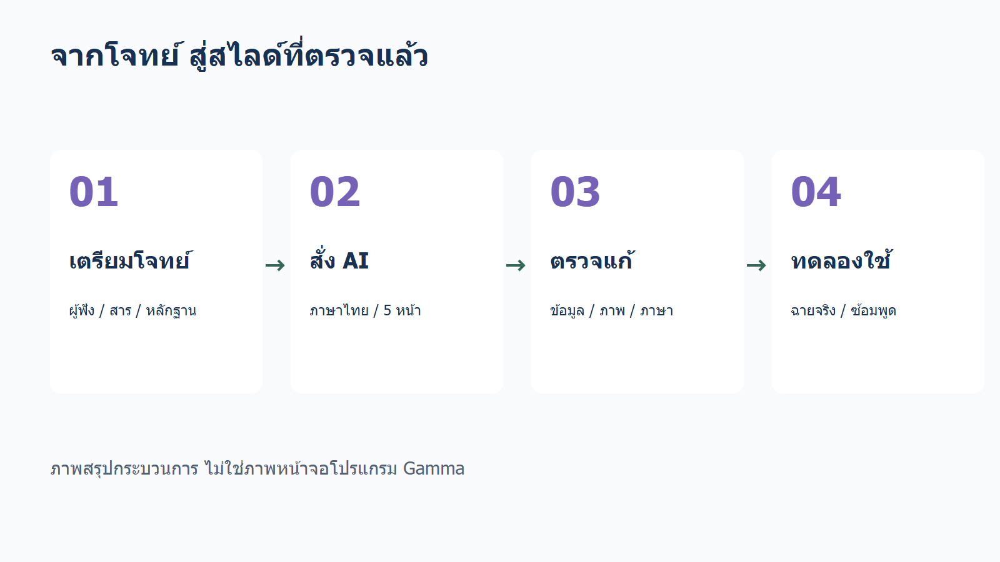

# หน่วยที่ 2 · สร้างสไลด์ภาษาไทยด้วย Gamma

[หน่วยก่อนหน้า](01-design-foundations.md) · [หน้าหลัก](../README.md) · [หน่วยถัดไป](03-professional-workshops.md)

เวลาแนะนำ 3 ชั่วโมง · ฉบับ 21 พฤศจิกายน 2569 · ตรวจคู่มือทางการ 27 พฤศจิกายน 2569

## เป้าหมายและสิ่งที่ต้องเตรียม

ผู้เรียนจะสร้างสไลด์ไทย 5 หน้า แก้ข้อความและเลย์เอาต์เอง ตรวจข้อมูลและการแสดงผลไทย แล้วส่งออกพร้อมบันทึกการใช้ AI เตรียมบัญชี Gamma Free คอมพิวเตอร์ เบราว์เซอร์ อินเทอร์เน็ต และ [ใบงานออกแบบจากหน่วย 1](../worksheets/01-design-brief.md)

กิจกรรมใช้เนื้อหาสมมติที่เตรียมไว้ ลดการใช้เครดิตด้วยการตรวจโครงก่อนสร้างและแก้จุดเล็กด้วยมือ สิทธิ์และยอดเครดิตในบัญชีจริงเป็นเงื่อนไขที่ต้องดู ณ เวลาเรียน ไม่ต้องเปิด Research หรือซื้อแผนเพื่อทำบทนี้



ภาพอธิบายกระบวนการที่ผู้จัดทำออกแบบ ไม่ใช่ภาพหน้าจอ Gamma ขั้นตอนด้านล่างเรียบเรียงจากคู่มือทางการ ยังไม่ได้ทดลองกับบัญชีผู้เรียนจริง

## 2.1 รู้จักคำสำคัญ

| คำในโปรแกรม | ความหมายและการใช้ |
| --- | --- |
| Presentation | รูปแบบงานนำเสนอ |
| Prompt | คำสั่งที่บอกผู้ฟัง เป้าหมาย เนื้อหา และรูปแบบ |
| Card / Slide | หน่วยหน้าของงาน แต่ Card อาจยาวกว่าอัตราส่วนสไลด์ถ้าปล่อยเนื้อหายาว |
| Agent | เส้นทางสร้างงานด้วยการสนทนาและตรวจแผน |
| Plan | ทบทวนโจทย์และแผนก่อนให้สร้าง เหมาะกับการฝึกควบคุมผลลัพธ์ |
| Express | สร้างร่างเร็วแล้วตรวจแก้ภายหลัง |
| Use classic generator | ทางเข้าสร้างแบบเดิม เมื่อบัญชีมีตัวเลือกนี้ |
| Generate / Paste / Import | สร้างจากหัวข้อ / ใช้ข้อความที่มี / นำเข้าไฟล์หรือ URL |
| Theme | ระบบสี ตัวอักษร และภาพรวมของชุด |
| Present | แสดงแบบนำเสนอเพื่อตรวจสิ่งที่ผู้ชมจะเห็น |
| Share / Export | แบ่งปันงาน / ส่งออกไฟล์ |

รายละเอียดเส้นทางจาก [Gamma Agent](https://help.gamma.app/en/articles/15002203-how-do-i-create-with-agent-in-gamma) และ [Gamma Classic](https://help.gamma.app/en/articles/7838093-how-do-i-create-a-new-presentation-document-or-webpage-in-gamma) ชื่อและตำแหน่งอาจต่างกันตามการอัปเดต

## 2.2 เข้าระบบและเตรียมภาษาไทย

1. เปิด [gamma.app](https://gamma.app/) เลือกเริ่มใช้ฟรีหรือเข้าสู่ระบบตามปุ่มที่แสดง
2. สร้างบัญชีด้วยวิธีที่ระบบเสนอ ถ้าใช้บัญชีสถานศึกษา ให้ตรวจว่าหน่วยงานอนุญาตเครื่องมือนี้
3. ตรวจว่าอยู่แผน Free และดูเครดิตที่บัญชีแสดง อย่าเลือกอัปเกรดเพียงเพื่อทำกิจกรรมนี้
4. พิมพ์ข้อความทดสอบ “สร้างสไลด์ภาษาไทย เรื่องการพกแก้วส่วนตัว” เพื่อเตรียมคำสั่ง ยังไม่ต้องกดสร้างจนอ่านโครงครบ
5. หากต้องการเปลี่ยนภาษาของเมนู ให้เปิดรูปผู้ใช้แล้วมองหา Language Settings เลือกจากภาษาที่มีจริง หากไม่มีไทย ใช้เมนูอังกฤษตามตาราง หรือใช้ Translate ของเบราว์เซอร์

การแปลหน้าเว็บแปลเฉพาะสิ่งที่เห็นในเบราว์เซอร์ ไม่ได้ยืนยันว่าตัวงานจะเป็นภาษาไทย ระบุใน prompt ว่า “เขียนทุกสไลด์เป็นภาษาไทย” และตรวจผลด้วยตนเอง [คู่มือภาษา Gamma](https://help.gamma.app/en/articles/11016506-how-do-i-use-gamma-in-my-preferred-language)

## 2.3 เขียน prompt ที่ตรวจผลได้

prompt ที่ดีมี **บทบาท + ผู้ฟัง + เป้าหมาย + ข้อมูลตั้งต้น + จำนวนหน้า + รูปแบบ + สิ่งที่ต้องตรวจ** การสั่งว่า “ทำสไลด์สวย ๆ” ยังไม่บอกว่าความสวยควรช่วยอะไร

คัดลอกตัวอย่างนี้แล้วปรับผู้ฟังและชื่อผู้จัดทำก่อนใช้

```text
ทำหน้าที่เป็นผู้ช่วยออกแบบงานนำเสนอเพื่อการเรียนรู้
สร้าง Presentation ภาษาไทย 5 สไลด์ สำหรับนักเรียนมัธยมปลาย
พูด 3 นาที เป้าหมายคือชวนทดลองพกแก้วส่วนตัว 1 สัปดาห์

ข้อมูลที่ให้ใช้:
นี่คือโครงการสมมติสำหรับฝึกออกแบบ ยังไม่มีผลดำเนินงานจริง
กิจกรรมมี 3 ขั้น: เตรียมแก้ว ตั้งเตือนก่อนออกจากบ้าน บันทึกการใช้ทุกวัน
เริ่มทดลองวันจันทร์ถัดจากวันที่เรียน ไม่ต้องระบุวันที่ปฏิทิน
ผู้จัดทำ: [ใส่ชื่อของตนเอง]

โครงเรื่อง:
1. เปิดเรื่องด้วยเหตุผลที่เริ่มพกแก้วได้
2. อุปสรรคในชีวิตประจำวัน: ลืมพก ไม่สะดวก ไม่มีจุดเติมน้ำที่ทราบ
3. วิธีเตรียมตัว 3 ขั้นตามข้อมูลข้างต้น
4. แบบบันทึก 1 สัปดาห์ ยังไม่มีตัวเลขผลลัพธ์
5. ชวนเลือกแก้วและตั้งเตือนวันนี้

ดีไซน์: เรียบ ทันสมัย สีพื้น #F7F5F0 ข้อความ #202124 สีเน้น #356859
หนึ่งประเด็นหลักต่อหน้า ใช้ฟอนต์ที่แสดงสระและวรรณยุกต์ไทยครบ
ใช้เลย์เอาต์แนวนอน 16:9 หรือใกล้เคียง หากระบบมีตัวเลือก
ให้หัวข้อเป็นประโยคสั้น เนื้อหาประมาณ 3 ข้อต่อหน้า
ใช้ภาพ placeholder หรือไม่มีภาพก่อน เพื่อตรวจเนื้อหา
ใช้ข้อมูลที่ให้เท่านั้น ไม่แต่งสถิติ ผลวิจัย ชื่อแหล่งอ้างอิง หรือโลโก้
ใส่หมายเหตุว่าเป็นโครงการสมมติสำหรับฝึกออกแบบ
เสนอแผน 5 หน้าก่อนสร้าง เพื่อให้ฉันตรวจ
```

คำสั่งกำหนดสิ่งที่ต้องการ แต่ AI อาจทำไม่ครบ เช่น จำนวนหน้า สัดส่วน หรือการไม่เพิ่มข้อมูล จึงต้องตรวจทุกข้อก่อนส่ง

## 2.4 เส้นทาง A: หน้าสร้างแบบ Agent

ใช้เส้นทางนี้เมื่อหน้า Home มีช่องสนทนาสร้างงาน หากเห็นตัวสร้างแบบเดิมให้ข้ามไปเส้นทาง B

1. เลือกรูปแบบ **Presentation** ใต้หรือใกล้ช่อง prompt ตามหน้าจอที่มี
2. วาง prompt เลือก **Plan** หากมีตัวเลือก เพื่อทบทวนโครงก่อนสร้าง
3. ตอบคำถามเรื่องผู้ฟัง เวลา และโทนให้ตรงกับโจทย์ ถ้า AI เสนอข้อมูลเพิ่ม ให้ขอใช้เฉพาะข้อความตั้งต้น
4. อ่านแผน: มี 5 หน้า ครบโครง ไม่เพิ่มสถิติ ไม่ใช้ภาพเกินจำเป็น และระบุโครงการสมมติ
5. ถ้าแผนผิด พิมพ์แก้ก่อนให้สร้าง เช่น “รวมหน้าอุปสรรคเป็นหน้าเดียว คงทั้งหมด 5 หน้า”
6. ยืนยันให้สร้างเมื่อแผนตรงโจทย์ จากนั้นรอจนสร้างครบและตรวจทั้งชุด

**จุดตรวจ:** ถ้าได้ 7 หน้าให้รวมและลบส่วนเกินอย่างมีเหตุผล อย่าถือว่า AI ทำครบเพียงเพราะภาพดูเรียบร้อย การใช้ Research เป็นฟังก์ชันตามแผนบริการ ไม่จำเป็นสำหรับกิจกรรมนี้ [คู่มือ Agent](https://help.gamma.app/en/articles/15002203-how-do-i-create-with-agent-in-gamma)

## 2.5 เส้นทาง B: Classic Generate และ Paste

ถ้ามี **Use classic generator** ให้เปิด แล้วเลือกเส้นทางตามสิ่งที่เตรียมมา

### สร้างจากหัวข้อด้วย Generate

1. เลือกสร้างงานด้วย AI แล้วเลือก **Generate**
2. เลือกงานนำเสนอ จำนวน 5 หน้า และภาษาไทยในตัวเลือกที่มี ถ้าไม่มีช่องภาษาให้ระบุใน prompt
3. วางโจทย์จากหัวข้อ 2.3 แล้วตรวจร่างหัวข้อก่อนขั้นสร้าง หากรุ่นนั้นมีหน้าทบทวน
4. เลือกธีมเรียบที่รองรับไทย ให้พื้นที่กับข้อความ และเลือกไม่เพิ่มภาพหรือ placeholder ก่อน
5. สร้างแล้วตรวจเทียบโจทย์ทั้ง 5 หน้า

### รักษาข้อความที่เตรียมไว้ด้วย Paste

1. เปิด [ข้อความฝึก 5 หน้า](../examples/prompts/unit-02-practice.txt) กด Raw บน GitHub หรือคัดลอกเนื้อหาในไฟล์
2. เลือก **Paste** หรือ **Paste in text** ตามหน้าจอ วางข้อความทั้งหมด
3. ใช้ `---` คั่นแต่ละหน้า ถ้ามีตัวเลือก **Preserve this exact text** ให้เลือกเมื่อจำเป็นต้องคงถ้อยคำ
4. ตรวจว่าสร้าง 5 หน้า ไม่เอาคำชี้แจงนอกเนื้อหามาเป็นสไลด์
5. ปรับธีมและภาพหลังตรวจข้อความครบ

ถ้าใช้ Agent ให้วางไฟล์ข้อความเดียวกันและบอกให้รักษาคำเดิม หนึ่งส่วนต่อหนึ่งสไลด์ ตัวคั่นเป็นแนวทางที่ระบบรองรับ แต่ยังต้องตรวจจำนวนหน้าที่ได้ [คู่มือการสร้างและตัวคั่น](https://help.gamma.app/en/articles/7838093-how-do-i-create-a-new-presentation-document-or-webpage-in-gamma)

## 2.6 ปรับดีไซน์ให้ดูเป็นชุดเดียวกัน

ทำกับหน้าแรกให้ลงตัวก่อนใช้หลักเดียวกันกับหน้าอื่น

1. เปิด **Theme** หรือแผงรูปแบบที่หน้าจอแสดง เลือกธีมพื้นเรียบที่เห็นไทยชัด หากมีการแก้สีในแผนที่ใช้ ให้กำหนดรหัสตามใบงาน 1 ถ้าทำไม่ได้เลือกธีมสำเร็จที่ใกล้เคียงและบันทึกข้อจำกัด
2. เลือกฟอนต์ไทยจากตัวเลือกที่มี ทดลองคำว่า “น้ำ ผู้เรียน เกื้อกูล ปฏิบัติ” ดูสระบน–ล่างและวรรณยุกต์ ไม่กำหนดว่าการอัปโหลดฟอนต์ต้องใช้ได้บน Free
3. ใช้หัวข้อใหญ่ เนื้อหารอง และที่มาแยกระดับชัด ถ้าเนื้อหาล้น ให้ย่อหรือแบ่งประเด็นก่อนลดตัวอักษร
4. เลือกเลย์เอาต์ให้ตรงชนิดเนื้อหา เช่น 3 ขั้นใช้คอลัมน์ 3 ส่วน การเทียบใช้ซ้าย–ขวา และผลใช้กราฟ
5. ลบรูปและไอคอนที่ไม่ได้ช่วยอธิบาย ตรวจแนวซ้าย ระยะขอบ และความหมายสีให้คงที่
6. หากมีตัวเลือกสัดส่วนหรือขนาดหน้า ให้ใช้ 16:9 เพื่อฝึกงานฉายจอ หากไม่มี ให้ควบคุมเนื้อหาไม่ให้ Card ยาวและตรวจหน้าส่งออกจริง

**ตัวอย่างแก้หัวข้อ:** “ประโยชน์และความสำคัญของการดำเนินโครงการ” → “เริ่มพกแก้วได้จากกิจวัตรเดิม” หัวข้อหลังบอกสารและเปิดทางให้ผู้พูดขยายรายละเอียด

## 2.7 แทรกภาพและรักษาความหมาย

1. ใช้คำสั่งแทรก/เปลี่ยนภาพของหน้า เลือก Upload หรือวิธีนำเข้าที่บัญชีมี
2. ทดลองใช้ [ภาพการร่วมทำงานที่เตรียมไว้](../assets/photos/teamwork.jpg) สำหรับหน้ากิจกรรมทีม หรือใช้ภาพที่ถ่ายเองให้ตรงเนื้อหา ภาพคนทำงานไม่ควรใช้แทนภาพหลักฐานการลดขยะ
3. ครอปให้พอดีโดยไม่ยืดสัดส่วน อย่าวางตัวอักษรทับส่วนภาพที่รายละเอียดแน่น
4. ใส่เครดิตในบันทึกแหล่งสื่อ และมีข้อความอธิบายสารของภาพ ถ้าเครื่องมือมีช่อง alt text ให้เติมด้วย
5. ถ้าสร้างภาพ AI ให้ระบุว่าเป็นภาพจำลอง ตรวจวัตถุและไม่ให้ภาพเป็นหลักฐานปลอม ใช้ข้อความไทยที่พิมพ์แยกเมื่อจำเป็นต้องแก้ได้

กิจกรรมหลักใช้ภาพที่ดาวน์โหลดหรือภาพตัวเองได้ ไม่บังคับใช้เครดิตสร้างภาพเพิ่มเติม [เครดิตภาพในหลักสูตร](../ASSET-CREDITS.md)

## 2.8 แก้เฉพาะจุดด้วย AI และด้วยมือ

ใช้คำสั่งที่ระบุหน้า ขอบเขต และสิ่งที่ต้องคงไว้

```text
แก้เฉพาะสไลด์ 2 ให้หัวข้อสั้นลงและเหลืออุปสรรค 3 ข้อ
คงความหมายเดิม ไม่เพิ่มสถิติ และอย่าเปลี่ยนข้อความหน้าอื่น
```

```text
ปรับเฉพาะเลย์เอาต์หน้า 3 เป็น 3 ขั้นตอนเรียงซ้ายไปขวา
คงข้อความและหมายเหตุว่าเป็นข้อมูลสมมติ ใช้สีเดิม
```

```text
ตรวจภาษาไทยทั้งชุด แล้วเสนอรายการคำที่ควรแก้พร้อมเหตุผลก่อนลงมือ
อย่าเพิ่มข้อมูลหรือเปลี่ยนชื่อเฉพาะที่ฉันให้
```

ถ้าต้องเปลี่ยนเพียงคำ เว้นบรรทัด หรือย้ายภาพ ให้แก้ด้วยมือและตรวจผลทันที ถ้าใช้ Classic ให้มองหาไอคอนประกายสำหรับแก้ด้วย AI รายหน้า การแก้ด้วย AI หลายหน้าพร้อมกันอาจขึ้นกับแผน ไม่ใช้เป็นเงื่อนไขผ่านบทเรียนนี้

## 2.9 ตรวจ 4 รอบก่อนส่งออก

| รอบ | สิ่งที่ตรวจ | ตัวอย่างข้อผิดพลาด |
| --- | --- | --- |
| ข้อเท็จจริง | เทียบข้อมูลกับต้นฉบับทีละข้อ | AI เพิ่มว่า “ลดขยะได้ 50%” ทั้งที่ไม่มีข้อมูล |
| ภาษาไทย | คำสะกด ชื่อเฉพาะ สระ วรรณยุกต์ และการตัดบรรทัด | “น้ำ” แสดงไม่ครบ หรือชื่อถูกเปลี่ยน |
| การออกแบบ | อ่านจากระยะใช้งาน สี แนว ระยะว่าง และกราฟ | ตัวอักษรบนภาพอ่านไม่ชัด |
| การใช้งาน | จำนวนหน้า Present ลิงก์ และไฟล์ที่ส่ง | ส่งออกมาเพียงหน้าปัจจุบัน |

อย่ารับที่มาที่ AI สร้างโดยไม่เปิดตรวจ ผู้เรียนต้องระบุข้อมูลจริง ข้อมูลสมมติ และข้อเสนอให้ชัด สำหรับงานฝึกนี้ข้อความตั้งต้นยังไม่มีผลลัพธ์จริง ห้ามเปลี่ยนแผนกิจกรรมให้เป็นผลสำเร็จแล้ว

## 2.10 นำเสนอ แชร์ และส่งออก

1. เปิด **Present** อ่านครบ 5 หน้า และจับเวลาพูดประมาณ 3 นาที
2. เปิด **Share** แล้ว **Export** หรือเมนู **… > Export** ตามรุ่นที่มี
3. เลือก **All cards** หากต้องการทั้งชุด ไม่เลือกเฉพาะหน้าปัจจุบัน
4. ส่งออก PDF สำหรับตรวจหน้าตา และ PPTX เมื่อจำเป็นต้องแก้ต่อในโปรแกรมอื่นตามสิทธิ์ที่หน้าจอแสดง
5. เปิดไฟล์ที่ดาวน์โหลดจริง นับ 5 หน้า ตรวจไทย ภาพ กราฟ และที่มา โดยเฉพาะ PPTX ซึ่งฟอนต์หรือการจัดวางอาจเปลี่ยนเมื่อเปิดอีกเครื่อง
6. หากแชร์ลิงก์ ให้เลือกผู้ชมที่เหมาะสม ตรวจด้วยหน้าต่างหรือบัญชีที่ไม่ได้เป็นเจ้าของ และบันทึกว่าผู้สอนเปิดได้หรือไม่

ขั้นตอนจาก [คู่มือส่งออก Gamma](https://help.gamma.app/en/articles/8022861-what-s-the-easiest-way-to-export-my-gamma) การส่งออกอ้างอิงสิ่งที่เห็นใน Present Mode Free อาจมีตรา Gamma ให้คงไว้ตามเงื่อนไข ไม่ถือเป็นข้อบกพร่องของงานเรียน

## 2.11 แก้ปัญหาที่พบบ่อย

| ปัญหา | วิธีแก้ |
| --- | --- |
| หา Generate ไม่เจอ | ใช้ prompt บน Agent หรือเปิด Use classic generator ถ้ามี |
| เมนูไม่มีภาษาไทย | ใช้ชื่ออังกฤษในบทเรียนหรือแปลหน้าเว็บ คงคำสั่งสร้างงานเป็นไทย |
| ได้ภาษาอังกฤษปน | ระบุภาษาทั้งชุดแล้วแก้คำที่เหลือด้วยมือ ตรวจชื่อเฉพาะก่อนแปล |
| เครดิตไม่พอ | ใช้ข้อความที่เตรียมไว้ แก้ด้วยมือ หรือทำต่อใน Slides/PowerPoint/Impress ที่เข้าถึงได้ บันทึกข้อจำกัด |
| การ์ดยาวเกินจอ | ย่อข้อความ แบ่งเนื้อหา และตรวจสัดส่วน/Present อีกครั้ง |
| ฟอนต์ไทยเปลี่ยนใน PPTX | เลือกฟอนต์ที่เครื่องปลายทางมี ตรวจทุกหน้า และใช้ PDF สำรอง |
| PDF มีเพียงหน้าเดียว | ตรวจ All cards แล้วส่งออกใหม่ |
| ที่มาที่ AI ให้เปิดไม่ได้ | ตัดข้ออ้างนั้นออกหรือหาแหล่งจริง อย่าใช้ URL ที่ตรวจไม่ได้ |

## งานฝึกและตรวจความเข้าใจ

ทำ [ใบงาน 2](../worksheets/02-gamma-lab.md) สร้าง 5 หน้า บันทึกอย่างน้อย 3 จุดที่แก้ พร้อมเหตุผลและภาพก่อน–หลัง 1 คู่ ส่งตาม [แบบส่งงาน](../worksheets/submission-template.md)

1. มีข้อความตรวจแล้วครบ 5 หน้า ควรเริ่มจากเส้นทางใด?
2. ทำไมไม่ควรสร้างทั้งชุดใหม่ทุกครั้งที่แก้คำสะกด?
3. สไลด์สวยแต่มีตัวเลขไม่มีที่มา ควรทำอย่างไร?
4. กด Export แล้วได้ไฟล์มา เหตุใดต้องเปิดตรวจอีก?

<details>
<summary>แนวคำตอบ</summary>

1. Paste หรือวางให้ Agent คงคำเดิม ใช้ `---` คั่นและตรวจผล
2. แก้เองควบคุมได้ตรงและประหยัดเครดิต การสร้างใหม่อาจเปลี่ยนส่วนที่ถูกแล้ว
3. เทียบต้นฉบับ ตัดหรือแทนด้วยข้อมูลที่ตรวจได้ ระบุข้อมูลสมมติถ้าใช้ฝึก
4. ต้องตรวจจำนวนหน้า ไทย ฟอนต์ ภาพ และเลย์เอาต์ในไฟล์ที่จะใช้จริง

</details>

[ทำใบงาน 2](../worksheets/02-gamma-lab.md) · [เริ่มเวิร์กช็อปหน่วย 3](03-professional-workshops.md)
