# หน่วยที่ 3 · เวิร์กช็อปงานนำเสนอระดับมืออาชีพ

[หน่วยก่อนหน้า](02-gamma-thai.md) · [หน้าหลัก](../README.md) · [หน่วยถัดไป](04-data-storytelling.md)

เวลาแนะนำ 6 ชั่วโมง · ฉบับ 21 พฤศจิกายน 2569

## เป้าหมายและรูปแบบกิจกรรม

ฝึกออกแบบให้เหมาะกับบริบท 3 แบบ ได้แก่ แนวมินิมอลสำหรับเปิดตัวความคิด งานประชุมทางการ และงานวิชาการ แต่ละแบบมีต้นแบบ 5 หน้า รวม **15 หน้า** ผู้เรียนต้องอธิบายเหตุผลด้านสาร ผู้ฟัง และหลักฐาน ไม่วัดจากความเหมือนภาพเพียงอย่างเดียว

ภาพทั้งหมดเป็นต้นแบบที่ผู้จัดทำออกแบบเอง ไม่ใช่ภาพหน้าจอจาก Gamma หรือสไลด์ของ Apple การจัดวางใน Gamma อาจต่างจากภาพ ให้รักษาลำดับสาร ความอ่านง่าย และองค์ประกอบสำคัญ ตัวอย่างวิชาการและประชุมเป็นสถานการณ์สมมติ ไม่มีผลวิจัยหรือมติจริง

เตรียมบัญชีและทักษะจากหน่วย 2 ใช้ [ใบงาน 3](../worksheets/03-workshop.md) ระหว่างฝึก เวลาแนะนำ: ทบทวน 20 นาที เวิร์กช็อป A 80 นาที B 80 นาที C 100 นาที วิจารณ์ 40 นาที ปรับและส่ง 40 นาที รวม 360 นาที

## 3.1 วิธีสร้างตามต้นแบบ

1. อ่านทั้ง 5 หน้าให้เข้าใจโครงเรื่องก่อนเปิดโปรแกรม
2. เปิดไฟล์ข้อความของเวิร์กช็อปนั้นบน GitHub กด Raw แล้วคัดลอก ห้ามคัดเฉพาะชื่อไฟล์
3. ใช้ Paste หรือวางให้ Agent และระบุให้รักษาถ้อยคำ หนึ่งส่วนต่อหนึ่งสไลด์ ตามขั้นตอนหน่วย 2
4. ให้ AI สร้าง 5 หน้า แล้วปรับธีมและองค์ประกอบทีละหน้า ไม่จำเป็นต้องใช้ภาพ AI เพิ่ม
5. เทียบภาพต้นแบบ คงสารหลัก แต่เปลี่ยนรายละเอียดให้เป็นของตนในรอบประยุกต์
6. ซ้อมพูดและเปิดไฟล์ส่งออกจริงก่อนส่ง

**คำสั่งกลาง** ใช้ก่อนหรือประกอบข้อความเนื้อหา อย่าให้กลายเป็นสไลด์เพิ่ม

```text
จัดข้อความต่อไปนี้เป็น Presentation ภาษาไทย 5 หน้า
ใช้ --- แบ่งหน้า คงชื่อเฉพาะและข้อมูลสมมติ ไม่เพิ่มสถิติหรือที่มา
ให้ข้อความเป็นองค์ประกอบที่แก้ได้ ไม่ทำทั้งหน้าเป็นภาพตัวอักษร
ใช้สัดส่วนแนวนอน 16:9 หากมีตัวเลือก และตรวจไม่ให้เนื้อหาล้นหน้า
เสนอแผนก่อนสร้าง และใช้ภาพ placeholder หรือรูปทรงเรียบ
```

## 3.2 เวิร์กช็อป A · แนวมินิมอลประยุกต์จากหลักการสไลด์ Apple

**บริบท:** นำเสนอแนวคิด FOCUS เรื่องวางสารก่อนออกแบบ ไม่ใช่ผลิตภัณฑ์หรือแบรนด์จริง ใช้พื้นที่ว่าง ข้อความใหญ่ ประเด็นเดียว และการเปลี่ยนจังหวะระหว่างหน้า เหมาะกับการพูดประกอบ ภาพอย่างเดียวมีรายละเอียดไม่พอสำหรับส่งอ่านโดยไม่มีผู้พูด

**ระบบภาพ:** พื้น `#0B1020` ข้อความ `#FFFFFF` เน้น `#B9A7FF` หนึ่งตระกูลฟอนต์ไทย เว้นขอบประมาณ 6–7% ใช้ [ข้อความ 5 หน้า](../examples/prompts/minimal-keynote.txt) และดู [ไฟล์ภาพทั้งหมด](../examples/01-minimal-keynote/README.md)

คำสั่งเสริม: “ใช้พื้นสีเข้ม ตัวอักษรใหญ่ สีเน้นม่วงอ่อน พื้นที่ว่างมาก ไม่มีโลโก้ Apple ไม่มีภาพผลิตภัณฑ์จริง ให้แต่ละหน้ามีจุดสนใจหลักหนึ่งจุด”

### A1 เปิดความคิด: คิดชัดก่อนเปิดสไลด์


**ทำตาม:** เลือกหน้าปก วาง FOCUS ขนาดรองด้านบน หัวข้อใหญ่ซ้าย 2 บรรทัด สร้างรูปทรงวงกลมเรียบด้านขวาหรือเลือกเลย์เอาต์ที่มีพื้นที่ภาพเทียบเคียง เว้นพื้นที่ระหว่างหัวข้อกับคำอธิบาย ไม่เพิ่มรายการยาวบนปก

**ผู้พูด:** “ก่อนเลือกสีและภาพ เราจะเริ่มจากความคิดที่อยากให้ผู้ฟังจำ” ใช้ราว 20 วินาที **ตรวจ:** อ่านหัวข้อได้จากระยะฉายและรู้ว่าเรื่องเกี่ยวกับการวางความคิด

### A2 หนึ่งหน้า หนึ่งความคิด

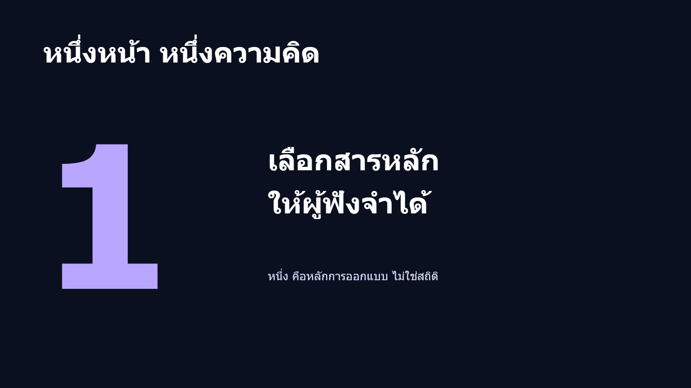

**ทำตาม:** ใช้เลข 1 เป็นภาพตัวอักษรเด่นซ้าย ข้อความ “เลือกสารหลักให้ผู้ฟังจำได้” ทางขวา ใส่คำอธิบายว่าเลขนี้เป็นหลักออกแบบ ไม่ใช่สถิติ ถ้าเลย์เอาต์ Gamma บังคับคอลัมน์ ให้ปรับสัดส่วนจนข้อความไม่เบียดกัน

**ผู้พูด:** ยกตัวอย่างหน้าเดียวที่มีหลายหัวข้อแล้วบอกว่าจะเลือกสารใดเป็นตัวหลัก **ตรวจ:** เลขใหญ่ทำหน้าที่ช่วยจำ ไม่สร้างความเข้าใจว่าเป็นผลวิจัย

### A3 จากเรื่องยาว สู่เรื่องที่จำได้

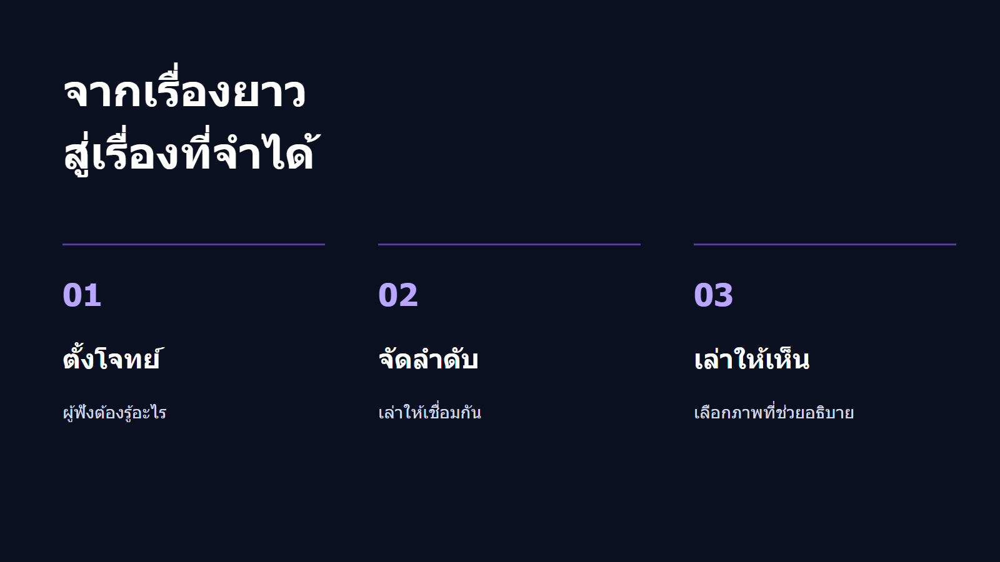

**ทำตาม:** ใช้ 3 คอลัมน์ที่เริ่มแนวเดียวกัน ใส่เลข 01–03 ชื่อขั้น และประโยคอธิบายสั้น ๆ ตั้งโจทย์ จัดลำดับ เล่าให้เห็น ใช้สีเน้นกับเลข ไม่เน้นทุกคำพร้อมกัน

**ผู้พูด:** เล่าเส้นทางจากผู้ฟังไปสู่การเลือกภาพ พร้อมยกตัวอย่างโจทย์ของตน **ตรวจ:** ลำดับอ่านซ้ายไปขวาชัดแม้ไม่มีลูกศร

### A4 ตัดสิ่งเกิน ให้สารชัดขึ้น

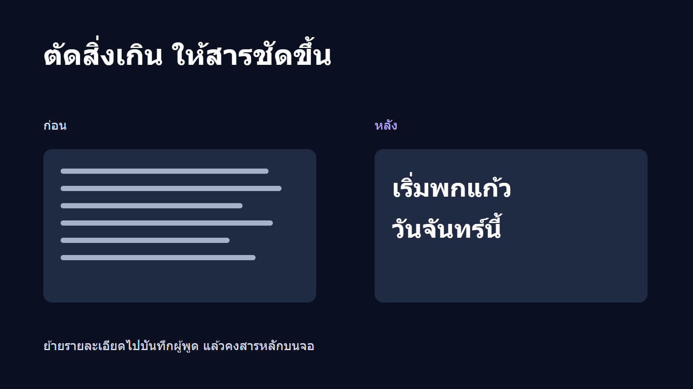

**ทำตาม:** แบ่งซ้าย–ขวา ตั้งชื่อ “ก่อน/หลัง” ด้านก่อนใช้รูปทรงเส้นแทนย่อหน้ายาวเพื่อสาธิตความหนาแน่น ด้านหลังวางข้อความจริง “เริ่มพกแก้ว วันจันทร์นี้” เก็บรายละเอียดอื่นไว้ในบันทึกผู้พูด

**ผู้พูด:** อธิบายว่าตัดความซ้ำและย้ายรายละเอียด ไม่ได้ตัดหลักฐานสำคัญ **ตรวจ:** ทั้งสองด้านเทียบกันได้ และด้านหลังมีสารชัดกว่า

### A5 จบด้วยสิ่งที่ให้ทำ

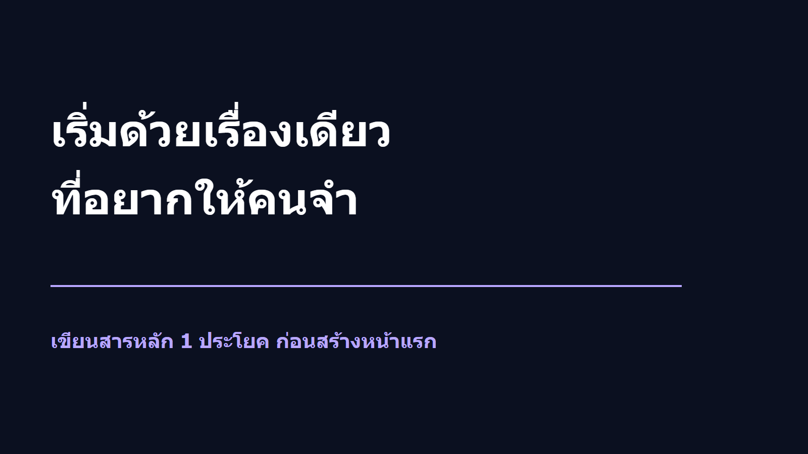

**ทำตาม:** ใช้หัวข้อ 2 บรรทัดและข้อความชวน “เขียนสารหลัก 1 ประโยค ก่อนสร้างหน้าแรก” วางเส้นคั่นเรียบได้ ไม่เพิ่ม QR ที่ไม่มีปลายทางจริง

**ผู้พูด:** ให้ผู้ฟังลองเขียนสารทันที 30 วินาที **ตรวจ:** คนดูรู้ว่าจะเริ่มทำอะไรหลังจบ

**งานประยุกต์ A:** เปลี่ยนเป็นแนวคิดของตน เช่น การอ่านวันละ 10 นาทีหรือการจัดโต๊ะเรียน รักษาโครง 5 หน้าและหลักจุดสนใจเดียว ใส่แหล่งจริงถ้ามีข้ออ้างเชิงข้อมูล ห้ามสร้างตัวเลขเพื่อให้ดูน่าเชื่อถือ

## 3.3 เวิร์กช็อป B · สไลด์เปิดประชุมอย่างเป็นทางการ

**บริบท:** ประชุมเตรียมกิจกรรมทักษะดิจิทัล ผู้ฟังคือคณะทำงานที่ต้องรู้วาระและสิ่งที่ขอให้ตัดสินใจ ความเป็นทางการเกิดจากความชัดและถูกต้องของชื่อ วันที่ และสถานะ ไม่จำเป็นต้องมีของตกแต่งจำนวนมาก

**ระบบภาพ:** พื้น `#F8FAFC` ข้อความ `#10243A` สีเน้น `#8A5A14` จัดชิดซ้าย เน้นวาระและคำขอมติ ใช้ [ข้อความประชุม](../examples/prompts/formal-meeting.txt) และดู [ชุดภาพ](../examples/02-formal-meeting/README.md)

คำสั่งเสริม: “ออกแบบการประชุมอย่างเป็นทางการ โทนน้ำเงินเข้มบนพื้นสว่าง เน้นสีทองเข้มเล็กน้อย ระบุสถานการณ์สมมติ แยกข้อเสนอออกจากมติ ไม่สร้างตราหรือชื่อหน่วยงานจริง”

### B1 ชื่อการประชุมและข้อมูลเปิดงาน

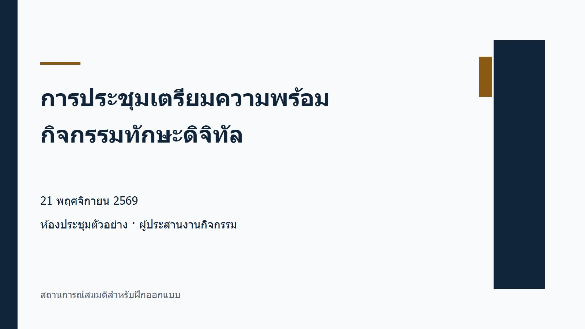

**ทำตาม:** ใช้ชื่อกิจกรรม 2 บรรทัด ตามด้วยวันที่ 21 พฤศจิกายน 2569 ห้องประชุมตัวอย่าง และบทบาทผู้ประสานงาน ใส่หมายเหตุสถานการณ์สมมติ ถ้าใช้กับงานจริงต้องเปลี่ยนวันที่และสถานที่ทุกจุดให้ตรงกัน

**ผู้พูด:** กล่าวต้อนรับและบอกเหตุผลที่ประชุม 20–30 วินาที **ตรวจ:** ไม่มีโลโก้หรือชื่อบุคคลที่ระบบแต่งขึ้น

### B2 วันนี้ต้องได้ข้อสรุป 3 เรื่อง

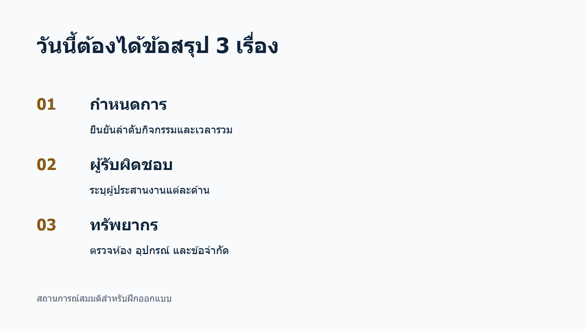

**ทำตาม:** วาง 3 รายการเรียงลงมา กำหนดการ ผู้รับผิดชอบ และทรัพยากร แต่ละรายการมีคำอธิบายหนึ่งบรรทัด แยกหัวข้อหนากับข้อความรองชัด

**ผู้พูด:** บอกผลลัพธ์ที่ต้องได้เพื่อกำกับการคุย **ตรวจ:** ผู้ฟังแยกได้ว่าวันนี้ต้องตัดสินใจอะไร ไม่ใช่แค่ทราบหัวข้อ

### B3 วาระและเวลารวม

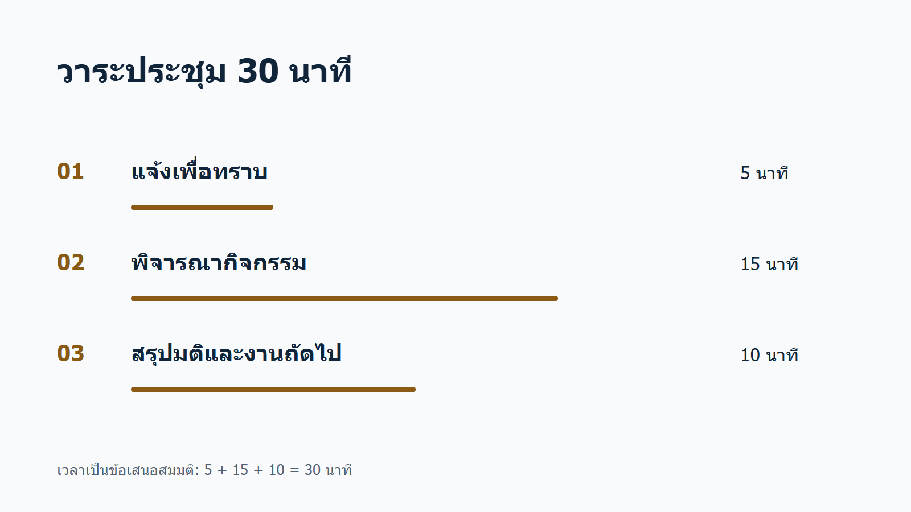

**ทำตาม:** ใส่ 3 วาระพร้อมเวลา 5, 15 และ 10 นาที รวม 30 นาที แถบใต้ข้อความใช้สัดส่วนเวลาเดียวกัน ถ้าทำเป็นข้อความล้วนก็ได้ แต่ตัวเลขรวมต้องถูกต้อง

**ผู้พูด:** บอกว่าช่วงพิจารณาใช้เวลามากที่สุดและจะช่วยรักษาเวลาอย่างไร **ตรวจ:** เวลาและแถบไม่ขัดกัน ไม่มีหัวข้อยาวจนชนคอลัมน์เวลา

### B4 ข้อเสนอเพื่อพิจารณา

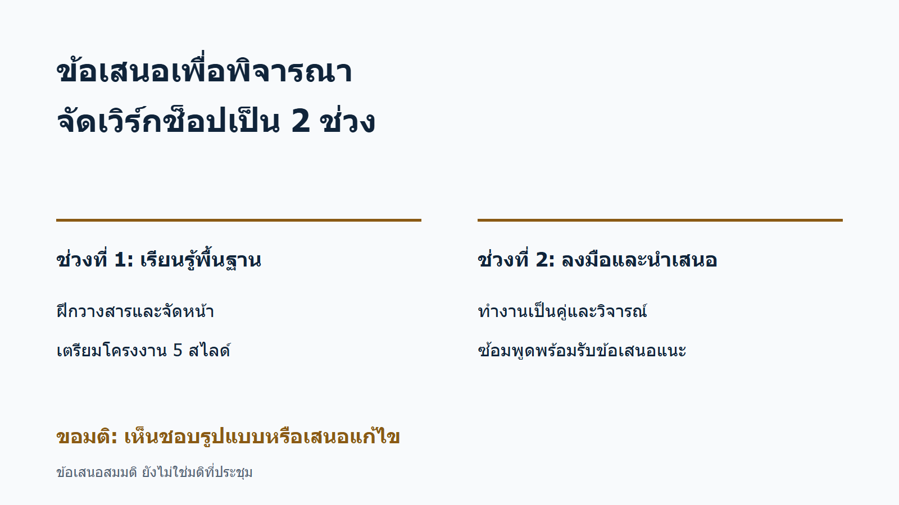

**ทำตาม:** แบ่ง 2 คอลัมน์อธิบายช่วงเรียนพื้นฐานและช่วงลงมือ แต่ละด้านมีชื่อและกิจกรรมย่อย 2 ข้อ ด้านล่างใส่ “ขอมติ: เห็นชอบรูปแบบหรือเสนอแก้ไข” พร้อมบอกว่ายังไม่ใช่มติ

**ผู้พูด:** เสนอเหตุผลของการแบ่งช่วงแล้วเปิดรับข้อแก้ไข **ตรวจ:** ถ้อยคำไม่เปลี่ยนข้อเสนอให้เป็นสิ่งอนุมัติแล้ว

### B5 แม่แบบบันทึกมติและติดตามงาน

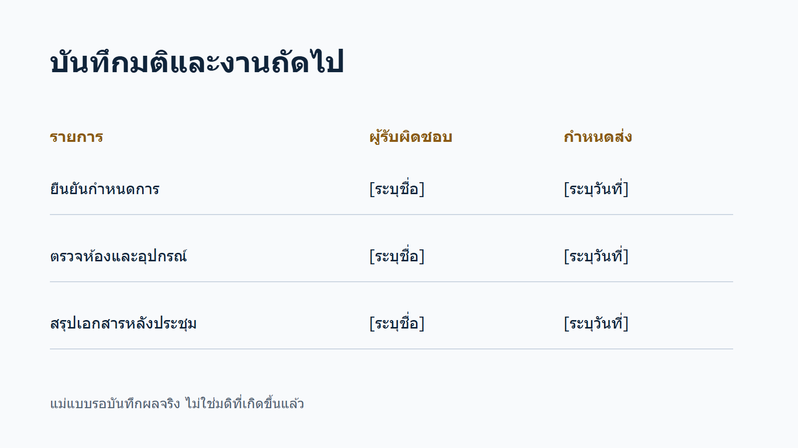

**ทำตาม:** สร้างตาราง 3 คอลัมน์ รายการ ผู้รับผิดชอบ กำหนดส่ง ใส่ `[ระบุชื่อ]` และ `[ระบุวันที่]` สำหรับรอข้อมูลจริง อย่าให้ AI แต่งชื่อและเส้นตาย หากกำลังฝึกให้คงป้ายแม่แบบไว้

**ผู้พูด:** อธิบายว่าจะเติมผลจริงหลังประชุมและทวนกับผู้รับผิดชอบ **ตรวจ:** แยกข้อมูลที่ยังว่างออกจากมติจริงได้

**งานประยุกต์ B:** เปลี่ยนเป็นการประชุมกลุ่มของตน 30 นาที คงโครง 5 หน้า ใช้บทบาทสมมติหรือชื่อที่ได้รับอนุญาต ตรวจยอดเวลา คำขอมติ และความสอดคล้องของวันที่

## 3.4 เวิร์กช็อป C · การนำเสนอเชิงวิชาการ

**บริบท:** ใช้สถานการณ์จำลองเปรียบเทียบเวลาในการร่างสไลด์ ผู้ฟังคือผู้เรียนและผู้สอนที่ต้องตรวจว่าคำถาม วิธีการ และข้อสรุปสัมพันธ์กัน ตัวอย่าง 5 หน้าเป็นรูปแบบย่อเพื่อฝึก ควรขยายที่มาและวิธีการเมื่อทำงานวิชาการจริง

**ระบบภาพ:** พื้นขาว ข้อความ `#183153` เน้น `#006D77` ใช้กราฟที่อ่านค่าได้ มีหน่วย แหล่งที่มา และข้อจำกัด เปิด [ข้อความวิชาการ](../examples/prompts/academic.txt), [ภาพครบชุด](../examples/03-academic/README.md) และ [ค่าสรุปสมมติ CSV](../examples/03-academic/simulated-summary.csv)

CSV นี้มีเพียงค่าเฉลี่ยที่ตั้งขึ้นกับขนาดกลุ่มสมมติ ไม่มีข้อมูลรายคน ห้ามนำไปคำนวณส่วนเบี่ยงเบนมาตรฐาน ค่า p หรืออ้างนัยสำคัญ

คำสั่งเสริม: “สร้างงานวิชาการอ่านชัด ใช้ค่าสมมติที่ให้เท่านั้น ระบุสมมติทุกหน้าที่ใช้ข้อมูล กราฟเวลาเริ่มแกนที่ศูนย์ ไม่มีการอ้างอิงปลอมหรือสรุปว่า AI เป็นเหตุให้ผลดีขึ้น”

### C1 ชื่อเรื่องและสถานะข้อมูล

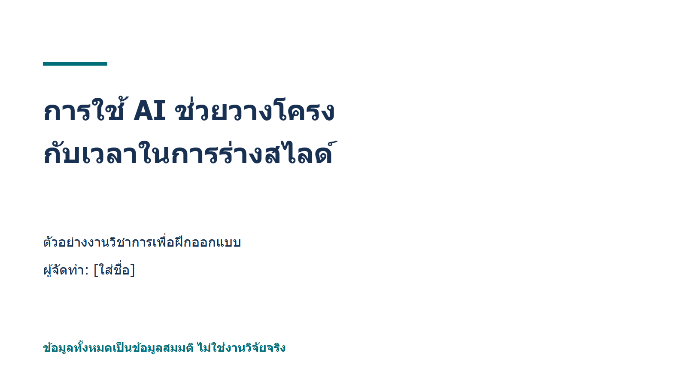

**ทำตาม:** วางชื่อเรื่อง 2 บรรทัด ระบุผู้จัดทำ และข้อความ “ข้อมูลทั้งหมดเป็นข้อมูลสมมติ ไม่ใช่งานวิจัยจริง” ในพื้นที่อ่านได้ ไม่ซ่อนไว้เป็นอักษรเล็กจนหาย

**ผู้พูด:** บอกว่าวันนี้ฝึกสื่อสารข้อมูลโดยใช้สถานการณ์จำลอง **ตรวจ:** ชื่อไม่อ้างผลที่ยังไม่มีหลักฐาน เช่น “AI ทำให้ทุกคนทำงานเร็วขึ้น”

### C2 คำถามและวัตถุประสงค์

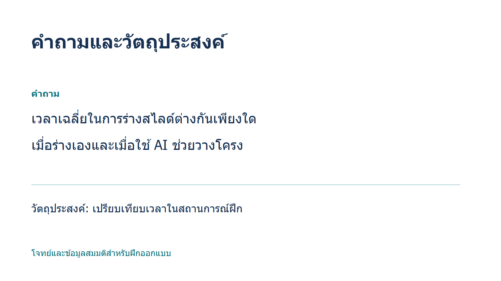

**ทำตาม:** แยกคำถามออกจากวัตถุประสงค์ ถามว่าเวลาเฉลี่ยต่างกันเพียงใดเมื่อร่างเองกับใช้ AI ช่วยวางโครง วัตถุประสงค์คือเปรียบเทียบเวลาในสถานการณ์ฝึก

**ผู้พูด:** อธิบายตัวแปรที่ดูคือเวลาในการร่าง ไม่ใช่คุณภาพหรือผลสัมฤทธิ์ระยะยาว **ตรวจ:** ตัวชี้วัดตอบคำถามได้และไม่เปลี่ยนประเด็นกลางเรื่อง

### C3 วิธีการในสถานการณ์จำลอง

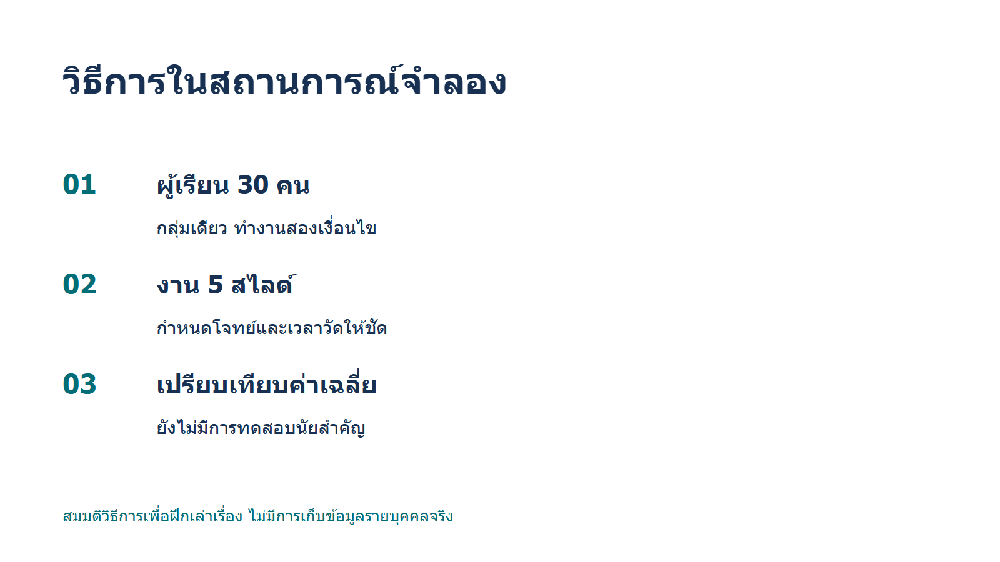

**ทำตาม:** วาง 3 ส่วน: กลุ่มสมมติ 30 คน งาน 5 สไลด์สองเงื่อนไข และการเทียบค่าเฉลี่ย ใส่ว่าไม่มีข้อมูลรายบุคคลจริง เมื่อต่อยอดเก็บจริงต้องกำหนดโจทย์ เวลาเริ่ม–จบ ลำดับเงื่อนไข และวิธีลดอคติให้ชัด

**ผู้พูด:** ชี้ว่ากลุ่มเดียวอาจได้ประโยชน์จากการฝึกซ้ำ **ตรวจ:** ไม่เรียกวิธีจำลองนี้ว่าการทดลองสุ่มควบคุม

### C4 ผลที่อ่านได้จากกราฟ

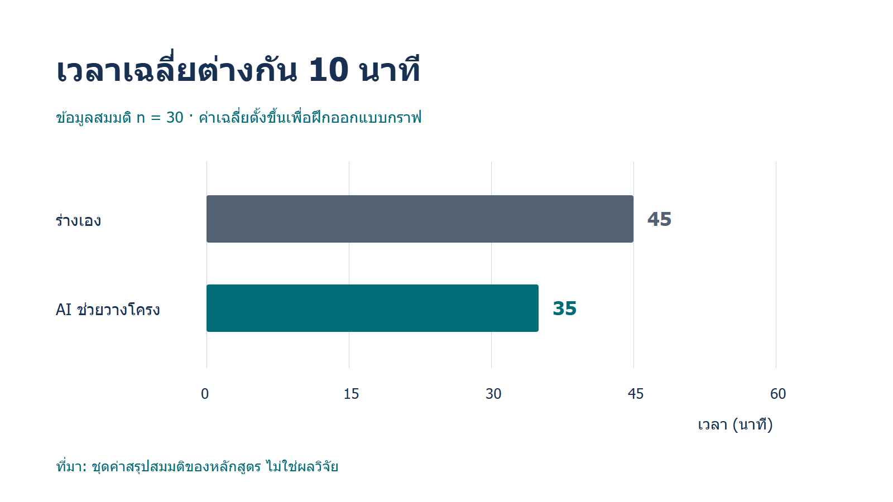

**ทำตาม:** ทำกราฟแท่งแนวนอน 2 แท่ง ร่างเอง 45 นาที และ AI ช่วย 35 นาที แกนเวลา 0–60 ใส่ค่าและหน่วย ป้ายสถานะข้อมูลสมมติ และที่มาว่าชุดค่าสรุปของหลักสูตร ถ้าสร้างกราฟใน Gamma ไม่ได้ ให้ใช้รูปกราฟต้นแบบพร้อมข้อความอธิบายค่า

**ผู้พูด:** “ค่าสมมติสองเงื่อนไขต่างกัน 10 นาที” เท่านั้น **ตรวจ:** ความยาวแท่งได้สัดส่วน 45:35 ไม่ใช้แกนเริ่ม 30 เพื่อขยายความต่าง และไม่สรุปนัยสำคัญ

### C5 ข้อสรุป ข้อจำกัด และงานถัดไป

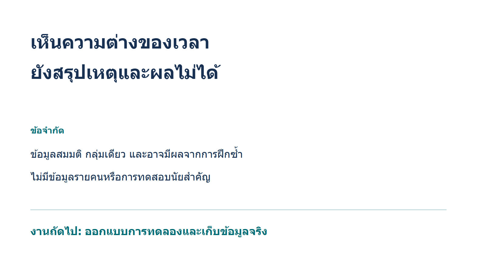

**ทำตาม:** สรุปเฉพาะความต่างของค่าเฉลี่ย ระบุข้อมูลสมมติ กลุ่มเดียว ผลจากการฝึกซ้ำ และไม่มีข้อมูลรายคน/การทดสอบนัยสำคัญ จบด้วยการเสนอเก็บข้อมูลจริงอย่างเหมาะสม

**ผู้พูด:** แยกสิ่งที่กราฟแสดงจากสิ่งที่ยังตอบไม่ได้ **ตรวจ:** ไม่มีคำว่า “พิสูจน์” หรือ “ทำให้” ที่เกินข้อมูล

**งานประยุกต์ C:** ใช้ข้อมูลสมมติเดิมเพื่อฝึกออกแบบใหม่ หรือใช้ข้อมูลจริงที่ตรวจสิทธิ์และที่มาได้ ถ้าเปลี่ยนข้อมูลให้เปลี่ยนหัวข้อ กราฟ และข้อสรุปทุกจุดพร้อมกัน ห้ามยืมค่าเฉลี่ยตัวอย่างไปแสดงเป็นผลของตน

## 3.5 วิจารณ์และปรับงาน

จับคู่สลับบทผู้พูดและผู้ฟัง ให้ผู้ฟังตอบ 4 ข้อ: สารหลักคืออะไร หลักฐานรองรับตรงไหน อ่านติดขัดจุดใด และหลังจบต้องทำอะไร ผู้พูดบันทึกข้อเสนอแนะ แก้ 3 จุดที่มีเหตุผล และเก็บภาพก่อน–หลัง 1 คู่

**ตัวอย่างคำวิจารณ์ที่ใช้ได้:** “หน้า C4 ฉันไม่เห็นหน่วยเวลา จึงไม่รู้ว่า 45 หมายถึงอะไร ช่วยใส่คำว่านาทีใกล้แกน” ให้ชี้ตำแหน่ง ปัญหา และผลต่อผู้ฟัง แทนคำว่า “ยังไม่สวย”

## 3.6 ผลงานส่งและเกณฑ์สำเร็จ

ส่งสไลด์ 3 ชุด ชุดละ 5 หน้า ลิงก์หรือไฟล์ต้นฉบับ ไฟล์ PDF ที่เปิดตรวจแล้ว ใบงาน 3 และบันทึกการใช้ AI ใช้ [เกณฑ์ 100 คะแนน](../worksheets/assessment.md) กับ [แบบส่งงาน](../worksheets/submission-template.md) หากผู้สอนย่อกิจกรรมให้เลือก 1 ชุด ต้องประกาศขอบเขตก่อนเริ่มและใช้เกณฑ์เดียวกัน

ผลงานสำเร็จเมื่อสารตรงผู้ฟัง มีข้อมูลที่ตรวจได้หรือระบุสมมติอย่างชัด อ่านไทยครบ จัดองค์ประกอบเป็นระบบ และมีหลักฐานการแก้ด้วยการตัดสินใจของผู้เรียน

## คำถามท้ายหน่วย

1. ทำไมสไลด์มินิมอลที่เหมาะกับพูดสดอาจไม่เหมาะกับส่งอ่านเอง?
2. ข้อเสนอเพื่อพิจารณาต่างจากมติอย่างไร?
3. ค่าเฉลี่ย 45 กับ 35 เพียงพอจะสรุปเหตุและผลหรือไม่?
4. ถ้าเลย์เอาต์ Gamma ไม่เหมือนต้นแบบ จะตัดสินว่างานใช้ได้จากอะไร?

<details>
<summary>แนวคำตอบ</summary>

1. รายละเอียดอยู่ที่ผู้พูด ต้องเพิ่มบันทึกหรือคำอธิบายสำหรับงานอ่านเอง
2. ข้อเสนอยังรอพิจารณา มติเป็นผลที่ที่ประชุมตัดสินใจแล้ว ต้องมีบันทึกจริง
3. ไม่พอ โดยเฉพาะค่าสมมติ ไม่มีข้อมูลรายคนและการออกแบบควบคุมตัวแปร
4. ตรวจสาร ความอ่านง่าย ลำดับข้อมูล ความถูกต้อง และความเหมาะกับผู้ฟัง

</details>
