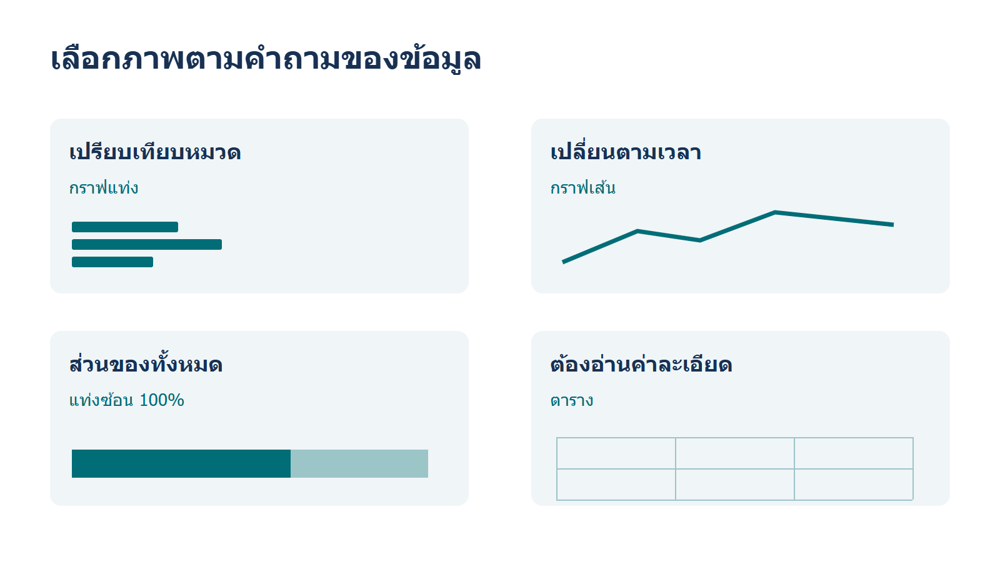
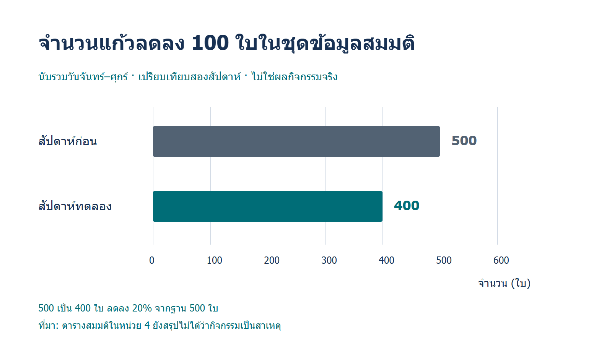

# หน่วยที่ 4 · การเล่าเรื่องด้วยข้อมูลและการออกแบบกราฟ

[หน่วยก่อนหน้า](03-professional-workshops.md) · [หน้าหลัก](../README.md) · [หน่วยถัดไป](05-media-and-delivery.md)

เวลาแนะนำ 3 ชั่วโมง · ฉบับ 21 พฤศจิกายน 2569 · ตรวจแหล่งวิธีออกแบบ 27 พฤศจิกายน 2569

## เป้าหมาย

ผู้เรียนจะตั้งคำถามจากข้อมูล เลือกกราฟเหมาะกับคำถาม คำนวณและตรวจค่าสรุป ออกแบบสไลด์ข้อมูลที่มีหน่วยและที่มา และเขียนข้อสรุปไม่เกินหลักฐาน ผลงานคือสไลด์ข้อมูล 5 หน้าและ [ใบงาน 4](../worksheets/04-data-story.md)

## 4.1 เริ่มจากคำถามที่ต้องตอบ

ข้อมูลชุดเดียวกันเล่าได้หลายแบบ เลือกคำถามก่อนเลือกกราฟ เช่น “มีจำนวนเปลี่ยนไปเท่าไร” ต้องรู้ฐานเปรียบเทียบ ส่วน “อะไรเป็นเหตุให้เปลี่ยน” ต้องมีการออกแบบศึกษาที่รองรับมากกว่าตัวเลขก่อน–หลัง

แยกองค์ประกอบ 4 อย่างให้ได้: **ข้อมูล** คือค่าที่มี **ข้อค้นพบ** คือรูปแบบที่อ่านได้ **ความหมาย** คือเหตุผลว่าผู้ฟังควรสนใจ **ข้อเสนอ** คือสิ่งที่ควรทำต่อ ความหมายและข้อเสนออาจมีสมมติฐาน ต้องไม่เขียนเหมือนเป็นข้อเท็จจริงที่วัดแล้ว

ตัวอย่างสำหรับผู้บริหารกิจกรรม: ข้อมูลนับแก้ว → พบจำนวนในสองสัปดาห์ต่างกัน → ควรตรวจสาเหตุและพฤติกรรมร่วม → เสนอเก็บข้อมูลเพิ่มก่อนขยายกิจกรรม

## 4.2 ตรวจตารางก่อนให้ AI ออกแบบ

ใช้ตารางนี้เป็นข้อมูลสมมติทั้งหน่วย ตัวเลขตั้งขึ้นสำหรับฝึก ไม่ใช่ผลกิจกรรมจริง หน่วยคือ **แก้วใช้ครั้งเดียวจำนวนใบ** ไม่ใช่จำนวนคนหรือจำนวนครั้งเติมน้ำ

| วัน | สัปดาห์ก่อน (ใบ) | สัปดาห์ทดลอง (ใบ) | ต่างกัน: ก่อนลบทดลอง (ใบ) |
| --- | ---: | ---: | ---: |
| จันทร์ | 120 | 100 | 20 |
| อังคาร | 100 | 85 | 15 |
| พุธ | 110 | 90 | 20 |
| พฤหัสบดี | 90 | 70 | 20 |
| ศุกร์ | 80 | 55 | 25 |
| **รวม 5 วัน** | **500** | **400** | **100** |

ตารางจำลองเทียบวันจันทร์–ศุกร์ของคนละสัปดาห์ ไม่มีวันที่ปฏิทินและจำนวนผู้มาใช้บริการ ห้ามสมมติว่าผู้ใช้เท่ากันหรือเรียก 500 ว่า “นักเรียน 500 คน”

ก่อนใช้ข้อมูลจริง ให้ตรวจคำจำกัดความ หน่วย ช่วงเวลา วิธีนับ ค่าหาย ค่าซ้ำ และแหล่งที่มา ค่าว่างไม่ได้แปลว่าศูนย์ เช่น ไม่ได้บันทึกวันพุธไม่เท่ากับวันพุธไม่มีแก้ว ถ้าไม่มีข้อมูลให้ระบุว่าไม่มีและอธิบายว่าจะจัดการอย่างไร

**คำนวณด้วยมือแล้วให้ AI ตรวจซ้ำ**

- ผลต่างจำนวน: `500 − 400 = 100 ใบ`
- ร้อยละที่ลดจากฐานเดิม: `(500 − 400) ÷ 500 × 100 = 20%`
- ค่าเฉลี่ยต่อวันในชุดนี้: `500 ÷ 5 = 100` และ `400 ÷ 5 = 80 ใบ/วัน`

คำว่า “ลดลง 20%” ต้องระบุฐาน 500 ใบ หากเปลี่ยนจาก 60% เป็น 80% จะต่าง **20 จุดเปอร์เซ็นต์** ส่วนการเพิ่มเชิงสัมพัทธ์คือประมาณ **33.3% จากฐาน 60%** ทั้งสองอย่างตอบคนละคำถาม อย่าใช้แทนกัน

## 4.3 เลือกกราฟตามความสัมพันธ์



| คำถาม | รูปแบบเริ่มต้น | จุดที่ต้องระวัง |
| --- | --- | --- |
| หมวดไหนมากกว่า | กราฟแท่ง | เริ่มแกนค่าที่ศูนย์สำหรับข้อมูลจำนวนไม่ติดลบ ใช้สเกลเดียวกัน |
| เปลี่ยนตามเวลาอย่างไร | กราฟเส้น | ระยะเวลาต้องเรียงถูก ช่องว่างเวลาต้องไม่ทำให้เข้าใจผิด |
| แต่ละส่วนเป็นเท่าไรของทั้งหมด | แท่งซ้อน 100% หรือวงกลมเมื่อหมวดน้อย | ส่วนต้องรวมเป็นฐานเดียวกันครบ 100% อย่ารวมชุดที่ซ้อนทับกัน |
| ต้องดูค่าหลายรายการอย่างแม่น | ตาราง | ใส่หน่วย จัดแนวตัวเลข และลดเส้นที่ไม่ช่วยอ่าน |
| ตัวแปรเชิงปริมาณสองตัวสัมพันธ์กันหรือไม่ | กราฟกระจาย | ความสัมพันธ์ไม่ได้พิสูจน์เหตุและผล ไม่ใช้กับตารางแก้วตัวอย่างนี้ |

กราฟแท่งใช้ความยาวเปรียบเทียบค่า การตัดฐานอาจขยายความต่างเกินจริง ดู [คำอธิบายจาก Datawrapper](https://www.datawrapper.de/docs/why-our-column-and-bar-charts-start-at-zero) กราฟเส้นอาจมีเหตุผลใช้ช่วงแกนที่ต่างออกไป แต่ต้องระบุชัดและไม่ชวนเข้าใจผิด

ไม่ใช้ 3D กับกราฟตัวอย่าง เพราะมุมมองทำให้เทียบความยาวยาก หลีกเลี่ยงแกนคู่ถ้าความต่างของหน่วยและสเกลทำให้ผู้ฟังตีความผิดได้

## 4.4 เปลี่ยนตารางให้เป็นสไลด์ที่มีสาร



ภาพนี้ใช้ค่าจากตาราง 4.2 แกนเริ่ม 0 ถึง 600 ใบ แท่งแสดง 500 และ 400 ใบ พร้อมตัวเลขและคำอธิบาย ไม่ใช้สีเพียงอย่างเดียวแยกความหมาย ตามแนวทาง [W3C Use of Color](https://www.w3.org/WAI/WCAG22/Understanding/use-of-color)

องค์ประกอบ 6 ส่วนที่ควรมี ได้แก่ หัวข้อที่บอกสาร กราฟที่ตรงคำถาม หน่วยและช่วงเวลา ป้ายค่า ที่มาและสถานะข้อมูล และข้อจำกัดที่จำเป็นต่อการตีความ

**หัวข้อที่เหมาะ:** “จำนวนแก้วลดลง 100 ใบในชุดข้อมูลสมมติ” **ข้อสรุปที่ยังใช้ไม่ได้:** “การพกแก้วทำให้ขยะลดลง 20% แน่นอน” เพราะข้อมูลนี้ยังไม่ควบคุมจำนวนคน วันหยุด หรือกิจกรรมอื่น และเป็นข้อมูลสมมติ

**ข้อความอธิบายกราฟ:** “ชุดสมมติเปรียบเทียบจำนวนแก้วใช้ครั้งเดียวรวมวันจันทร์ถึงศุกร์ สัปดาห์ก่อน 500 ใบ สัปดาห์ทดลอง 400 ใบ ต่าง 100 ใบ หรือ 20% ของฐานเดิม ยังไม่พิสูจน์สาเหตุ” ใช้ข้อความนี้ใกล้กราฟหรือในบันทึกเพื่อให้คนที่อ่านภาพไม่ได้เข้าถึงสารได้

## 4.5 ใช้ AI ช่วยตรวจแทนการเชื่อทันที

คัดตารางพร้อมคำจำกัดความให้ AI ไม่ส่งเฉพาะตัวเลขที่ไร้บริบท

```text
ตรวจตารางสมมติเรื่องจำนวนแก้วต่อไปนี้ ไม่ใช่ข้อมูลจริง
วัน: จันทร์ อังคาร พุธ พฤหัสบดี ศุกร์
สัปดาห์ก่อน: 120, 100, 110, 90, 80 ใบ
สัปดาห์ทดลอง: 100, 85, 90, 70, 55 ใบ

คำนวณผลรวม ผลต่าง และเปอร์เซ็นต์ที่ลดจากฐานสัปดาห์ก่อน
แสดงสูตรและขั้นคำนวณ แล้วเสนอหัวข้อสไลด์ที่ไม่สรุปเหตุและผล
บอกด้วยว่าข้อมูลใดหายไปหากจะเทียบอัตราต่อผู้ใช้บริการ
ห้ามเพิ่มจำนวนคน วันที่ แหล่งอ้างอิง หรือผลทดสอบนัยสำคัญ
```

เทียบคำตอบกับสูตรใน 4.2 ถ้า AI ได้ค่าผิด ให้แก้ข้อมูลต้นทางก่อนนำไปสร้างกราฟ บันทึกคำตอบผิดเป็นหลักฐานการตรวจ ไม่ต้องสร้างใหม่หลายรอบเพื่อให้คำตอบดูน่าเชื่อถือ

## 4.6 สร้างกราฟในงานนำเสนอ

1. เตรียมตารางสรุป 2 แถว สัปดาห์ก่อน 500 และสัปดาห์ทดลอง 400 พร้อมหน่วยใบ
2. ใน Gamma เปิดหน้าที่ใช้แสดงผล มองหาการแทรกกราฟ/ตารางหรือให้ Agent จัดกราฟจากข้อมูลที่ให้ แล้วตรวจชนิดและค่า
3. ถ้าปรับกราฟได้ ให้ใช้แท่งแนวนอน เริ่มศูนย์ ตั้งเพดาน 600 และติดป้าย 500/400 ถ้าระบบเลือกสเกลอื่นที่เริ่มศูนย์และไม่บิดข้อมูล ใช้ได้โดยระบุหน่วยชัด
4. หากบัญชีทำกราฟแบบที่ต้องการไม่ได้ ใช้ [PNG ที่เตรียมไว้](../assets/diagrams/data-story.png) เป็นตัวอย่าง พร้อมข้อความอธิบายและตารางค่า หรือสร้างในเครื่องมือกราฟที่เข้าถึงได้แล้วนำเข้าภาพ
5. ตรวจความยาวแท่งและตัวเลขทีละจุด รวมถึงหัวข้อ หมายเหตุ และบทพูดที่กล่าวถึงค่าเดียวกัน
6. ส่งออก PDF แล้วเปิดเทียบกับตารางเดิม อย่าประเมินเพียงภาพในหน้าต่างแก้ไข

ไม่ถือว่าการให้ AI วาดกราฟเป็นรูปภาพทำให้ตัวเลขถูกเสมอ หากกราฟอ่านค่าผิดให้แก้หรือแทนด้วยกราฟที่ตรวจได้

## 4.7 เวิร์กช็อป 5 หน้า: เสนอเก็บข้อมูลเพิ่มก่อนขยายกิจกรรม

| หน้า | เนื้อหา | ผู้เรียนต้องออกแบบ |
| --- | --- | --- |
| 1 | โจทย์ลดแก้วใช้ครั้งเดียว | ผู้ฟังและคำถามที่จะตอบ ระบุสมมติ |
| 2 | วิธีนับและตารางต้นทาง | หน่วยใบ ช่วงจันทร์–ศุกร์สองสัปดาห์ และข้อมูลที่ยังไม่มี |
| 3 | กราฟรวม 500/400 ใบ | กราฟแท่ง หัวข้อสาร ค่า หน่วย และที่มา |
| 4 | ข้อจำกัด | ไม่ทราบจำนวนผู้ใช้และปัจจัยอื่น จึงยังตอบเรื่องสาเหตุไม่ได้ |
| 5 | ข้อเสนอถัดไป | เก็บจำนวนผู้ใช้ วัน/เวลา และวิธีนับให้สม่ำเสมอ แล้วทบทวนอีกครั้ง |

ใช้ [ข้อความพร้อมนำเข้า](../examples/prompts/unit-04-data-story.txt) ทำตามขั้นตอนหน่วย 2 แล้วเปลี่ยนเพียงรูปแบบการสื่อสาร ไม่เปลี่ยนตัวเลขหรือสถานะสมมติโดยไม่บันทึก

**เวลา 180 นาที:** บรรยายและอ่านข้อมูล 30 นาที เลือกกราฟ/คำนวณ 30 นาที สร้างสไลด์ 60 นาที วิจารณ์ 30 นาที ปรับและตอบคำถาม 30 นาที

## 4.8 ประเมินและคำถามท้ายหน่วย

ใช้ [ใบงาน 4](../worksheets/04-data-story.md) ตรวจ 5 เรื่อง เรื่องละ 4 คะแนน รวม 20: คำนวณถูก กราฟเหมาะ ป้ายและหน่วยครบ ข้อสรุปไม่เกินข้อมูล และมีหลักฐานแก้ไข ผ่าน 14 คะแนนขึ้นไป พร้อมแก้ค่าหรือข้อสรุปผิดก่อนส่ง

1. ตัวอย่างนี้ลดลงกี่ใบและกี่เปอร์เซ็นต์จากฐานใด?
2. ถ้าคนมาใช้บริการสัปดาห์ทดลองน้อยลง จะยังอ้างว่าพกแก้วเป็นสาเหตุได้หรือไม่?
3. ช่องว่างในตารางควรแทนด้วยศูนย์ทันทีหรือไม่?
4. ทำไมกราฟแท่งนี้ควรเริ่มศูนย์?
5. ถ้าไม่เห็นสีของกราฟ จะยังเข้าใจสองกลุ่มได้อย่างไร?

<details>
<summary>แนวคำตอบ</summary>

1. 100 ใบ และ 20% จากฐาน 500 ใบ
2. ไม่ได้ ต้องมีข้อมูลและการออกแบบศึกษาที่ช่วยแยกปัจจัยอื่น
3. ไม่ควร ค่าว่างอาจหมายถึงไม่ได้เก็บ ต้องตรวจและระบุวิธีจัดการ
4. ผู้ฟังเปรียบเทียบค่าจากความยาวแท่ง ฐานศูนย์ช่วยรักษาสัดส่วน
5. อ่านชื่อกลุ่ม ตัวเลข หน่วย และข้อความสรุปที่ใช้ประกอบสี

</details>

[ใบงาน 4](../worksheets/04-data-story.md) · [เรียนหน่วย 5](05-media-and-delivery.md)
