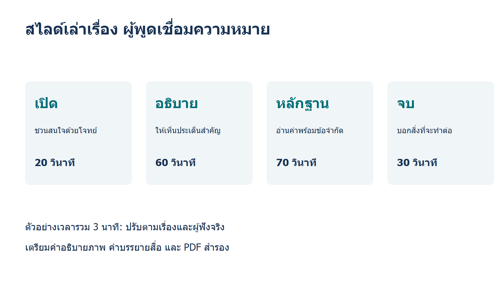

# หน่วยที่ 5 · สื่อประกอบ การเคลื่อนไหว และทักษะการนำเสนอ

[หน่วยก่อนหน้า](04-data-storytelling.md) · [หน้าหลัก](../README.md) · [หน่วยถัดไป](06-capstone.md)

เวลาแนะนำ 3 ชั่วโมง · ฉบับ 21 พฤศจิกายน 2569 · ตรวจคู่มือ Gamma 27 พฤศจิกายน 2569

## เป้าหมาย

เลือกสื่อที่ช่วยอธิบายสาร เขียนบันทึกผู้พูด ใช้จังหวะการแสดงผลอย่างเหมาะสม ซ้อมตามเวลา ตอบคำถามโดยอิงหลักฐาน และเตรียมไฟล์สำรอง ผู้เรียนใช้สไลด์ 5 หน้าจากหน่วย 3 หรือ 4 มาปรับพร้อมนำเสนอ 3 นาที ทำ [ใบงาน 5](../worksheets/05-delivery-lab.md)

## 5.1 ให้สื่อทำหน้าที่ชัดเจน

สื่อแต่ละชิ้นควรตอบว่า “ช่วยให้ผู้ฟังเข้าใจอะไรที่ข้อความล้วนยังอธิบายได้ไม่ดี” เช่น ภาพช่วยเห็นสภาพจริง แผนภาพช่วยเห็นขั้นตอน คลิปช่วยเห็นการกระทำต่อเนื่อง เสียงช่วยได้ยินตัวอย่างที่กำลังศึกษา

| สารที่อยากสื่อ | สื่อที่เลือกได้ | การตัดสินใจ |
| --- | --- | --- |
| วิธีพกแก้วให้หยิบง่าย | ภาพ 3 ขั้นหรือคลิปสั้น | ถ้าไม่ต้องเห็นการเคลื่อนไหว ใช้ภาพคงที่ก็อธิบายได้ |
| เปรียบเทียบจำนวนสองกลุ่ม | กราฟพร้อมคำอธิบาย | เสียงประกอบไม่ช่วยตรวจค่า ให้คงข้อมูลชัด |
| บอกปัญหาพื้นที่ทำงาน | ภาพที่ถ่ายเองพร้อมป้ายจุดสำคัญ | ใช้ภาพให้ตรงสภาพที่จะกล่าวถึง |
| อธิบายลำดับกระบวนการ | แผนภาพหรือเผยทีละขั้น | ใช้การเคลื่อนไหวเท่าที่ช่วยติดตาม |

ใช้ภาพความละเอียดพอกับจอ รักษาสัดส่วน ลดขนาดไฟล์โดยยังอ่านรายละเอียดที่สำคัญได้ หากนำคลิปจากเว็บมาใช้ต้องตรวจสิทธิ์และการเข้าถึงปลายทาง การมี URL ให้ดูไม่ได้แปลว่าดาวน์โหลดและเผยแพร่ใหม่ได้เสมอ

## 5.2 วางแผนสื่อก่อนถ่ายหรือสร้าง


ภาพถ่ายจาก Unsplash ใช้ประกอบแนวคิดการเตรียมงานร่วมกัน [เครดิต](../ASSET-CREDITS.md)

**กิจกรรมตัวเลือก: คลิปสาธิต 20 วินาที** ถ่ายวัตถุและมือจัดแก้วลงกระเป๋าตามสตอรีบอร์ดนี้ หรือทำเป็นภาพนิ่ง 3 ภาพถ้าไม่มีอุปกรณ์ถ่าย ทั้งสองแบบประเมินจากการอธิบายสารเดียวกัน

| เวลา | ภาพ | คำพูด/ข้อความ |
| --- | --- | --- |
| 0–5 วินาที | แก้วที่สะอาดวางข้างกระเป๋า | เลือกแก้วที่พกสะดวก |
| 5–12 วินาที | จัดแก้วในช่องที่เหมาะและหยิบง่าย | เตรียมไว้ใกล้ของที่ใช้ทุกวัน |
| 12–20 วินาที | แสดงบันทึกเตือนที่ตั้งขึ้นเพื่อสาธิต | ตั้งเตือนและบันทึกเมื่อใช้จริง |

นี่เป็นแบบฝึกถ่ายคลิป ไม่ได้มีไฟล์วิดีโอสำเร็จในคลัง มี [ตัวอย่างคำบรรยาย SRT](../examples/delivery/cup-demo-captions.srt) สำหรับปรับเวลาให้ตรงกับคลิปที่ผู้เรียนถ่าย SRT เป็นข้อความคำบรรยาย ไม่ใช่ไฟล์วิดีโอ และการใช้ขึ้นกับเครื่องมือเล่นสื่อ

ถ้าให้ AI สร้างภาพ ใช้ภาพเชิงแนวคิดพร้อมระบุที่มา ส่วนภาพหลักฐานเหตุการณ์ใช้ภาพที่ตรวจสอบได้ บันทึก prompt วันที่ เครื่องมือ และสิทธิ์ที่แสดงในบริการ

```text
สร้างภาพประกอบแนว editorial ของแก้วใช้ซ้ำข้างกระเป๋านักเรียน
ภาพเรียบ โทนพื้นสว่าง เว้นพื้นที่สำหรับหัวข้อด้านซ้าย 16:9
ไม่มีตัวอักษร โลโก้ หรือเครื่องหมายหน่วยงาน
ใช้เป็นภาพแนวคิด ไม่อ้างว่าเป็นภาพเหตุการณ์จริง
```

พิมพ์ข้อความไทยเป็นกล่องข้อความแยกในสไลด์เพื่อแก้ไขได้ ตรวจภาพที่สร้างก่อนใช้ทุกครั้ง กิจกรรมหลักใช้ภาพในคลังหรือภาพถ่ายเองได้โดยไม่ใช้เครดิตสร้างภาพ

## 5.3 แทรกสื่อและออกแบบการเข้าถึง

1. เลือกหน้าที่ต้องใช้สื่อ ระบุว่าภาพหรือคลิปอธิบายประเด็นใด
2. ใช้คำสั่งแทรกภาพ/สื่อหรือบล็อกสื่อที่บัญชีมี สำหรับคลิปให้ใช้ไฟล์หรือลิงก์ที่เครื่องมือรองรับตามหน้าจอจริง
3. ทดสอบกดเล่นใน Present ที่อุปกรณ์ปลายทาง ตรวจภาพ เสียง และการเชื่อมต่อ
4. เพิ่มคำอธิบายภาพหรือบทถอดเสียงที่มีสารสำคัญครบ หากมีช่อง alt text ให้ใส่ด้วย
5. คลิปที่มีคำพูดควรมีคำบรรยายที่ตรงเสียงและเวลาจริง ตรวจคำไทยที่ระบบถอดผิด อ้างอิงแนวทาง [W3C Captions](https://www.w3.org/TR/2023/REC-WCAG22-20231005/#captions-prerecorded)
6. เตรียมภาพนิ่งและข้อความสรุปเนื้อหาคลิปในไฟล์สำรอง เพราะ PDF ไม่เล่นคลิป และสื่อออนไลน์อาจเข้าถึงไม่ได้ที่ปลายทาง

ตัวอย่างคำอธิบายที่ให้สาร: “มือจัดแก้วใช้ซ้ำลงช่องข้างกระเป๋าเพื่อให้หยิบได้สะดวก” มีประโยชน์กว่าคำว่า “รูปแก้ว” ถ้ากราฟสำคัญ ให้เขียนค่าและข้อจำกัดเป็นข้อความด้วย

## 5.4 ใช้การเคลื่อนไหวเพื่ออธิบาย

แยก 3 เรื่องให้ชัด: การเผยเนื้อหาทีละส่วน การเปลี่ยนหน้าสไลด์ และคลิปเคลื่อนไหวที่วางบนหน้า เครื่องมือแต่ละตัวรองรับต่างกัน อย่าคาดว่าเอฟเฟกต์แบบ PowerPoint จะมีชื่อหรือพฤติกรรมเหมือนกันใน Gamma

ตามคู่มือ Gamma ที่ตรวจ **AI animations** คือคลิปที่สร้างจากคำสั่งและมีข้อจำกัดแผน ไม่ใช่การเปลี่ยนหน้าหรือแอนิเมชันข้อความแบบ PowerPoint กิจกรรมนี้ไม่กำหนดให้ใช้ฟังก์ชันดังกล่าว [คู่มือ Gamma AI Animations](https://help.gamma.app/en/articles/13920980-how-do-i-add-animations-in-gamma)

ฝึกด้วยวิธีที่บัญชีมีจริง: ใช้หน้าแยกอธิบายแต่ละขั้น หรือใช้การเน้นบล็อกใน Present หากมี อย่าให้สารสำคัญปรากฏเฉพาะช่วงสั้น ๆ จนผู้ฟังตามไม่ทัน การส่งออกเป็นภาพ/PDF ต้องยังเข้าใจได้โดยไม่มีการเคลื่อนไหว

**กิจกรรม 10 นาที:** อธิบายกระบวนการเดียวกันแบบแสดงพร้อมกันกับแบบทีละขั้น ให้เพื่อนบอกว่าแบบใดตามได้ง่ายกว่าและเพราะอะไร เลือกแบบที่ทำให้เข้าใจลำดับ ไม่เพิ่มเอฟเฟกต์ทุกบล็อก

## 5.5 เขียนบันทึกผู้พูด



บันทึกผู้พูดควรมีประโยคเปิด คำอธิบายหลักฐาน จุดเชื่อมกับหน้าถัดไป และเวลาเป้าหมาย เขียนเป็นคำหลักและประโยคที่จำเป็นแทนการคัดทุกคำจากสไลด์

ตัวอย่างกับงานข้อมูลหน่วย 4:

| หน้า | เวลา | สิ่งที่พูดเพิ่มจากหน้าจอ |
| --- | ---: | --- |
| 1 โจทย์ | 20 วินาที | บอกผู้ฟังและระบุว่าใช้สถานการณ์สมมติ |
| 2 วิธีนับ | 60 วินาที | อธิบายหน่วยและความต่างของสัปดาห์ ไม่อ่านทุกช่องในตาราง |
| 3 กราฟ | 50 วินาที | อ่าน 500/400 ผลต่าง 100 ฐาน 500 และข้อจำกัด |
| 4 สิ่งที่ยังไม่รู้ | 20 วินาที | ยกตัวอย่างจำนวนผู้ใช้บริการที่ยังไม่มี |
| 5 ข้อเสนอ | 30 วินาที | ชวนตกลงว่าจะเก็บข้อมูลอะไรเพิ่ม |
| **รวม** | **180 วินาที** | **3 นาที** |

ดู [บันทึกผู้พูดตัวอย่างครบ 5 หน้า](../examples/delivery/speaker-notes.md) แล้วปรับภาษาของตนเอง อย่าอ่านสคริปต์ที่ AI สร้างโดยไม่เข้าใจ

**ทำใน Gamma:** เปิดหน้าที่ต้องการแล้วมองหาบันทึกผู้พูดบริเวณมุมขวาบนของสไลด์ตามคู่มือ เพิ่มข้อความแต่ละหน้า จากลูกศรข้าง Present เลือก **Presenter View** หากบัญชีแสดง ใช้ปุ่มลูกศรเดินหน้า–ถอยหลังและตัวจับเวลาถ้ามี ถ้าตำแหน่งเปลี่ยนหรือไม่พบ ให้ใช้ไฟล์โน้ตแยก [คู่มือ Speaker Notes](https://help.gamma.app/en/articles/11047307-can-i-use-speaker-notes-while-presenting-in-gamma)

## 5.6 ซ้อม 3 รอบและใช้ AI อย่างมีขอบเขต

| รอบ | เป้าหมาย | สิ่งที่บันทึก |
| --- | --- | --- |
| 1 ความเข้าใจ | เล่าจบโดยอธิบายภาพและคำสำคัญได้ | หน้าที่อ่านติด ข้อมูลที่ยังตอบไม่ได้ |
| 2 เวลา | จับเวลารวมและแต่ละช่วง | ส่วนที่ควรย่อหรือขยาย |
| 3 สภาพใช้งาน | ฉายจอ/แชร์หน้าต่าง ทดสอบเสียงและไฟล์ | ผู้ชมเห็นอะไร เปิดไฟล์สำรองได้หรือไม่ |

ก่อนรอบถัดไปแก้จุดใหญ่ที่สุด 1–2 จุด แล้วซ้อมใหม่ เป้าหมายฝึกคือราว 3 นาที ช่วง 2:45–3:15 ใช้เป็นแนวทาง หากต้องปรับเพื่อการเข้าถึงให้ผู้สอนกำหนดเวลาที่เหมาะสมก่อนประเมิน

```text
นี่คือบันทึกผู้พูด 5 หน้าและเนื้อหาที่ตรวจแล้ว
ช่วยเสนอการย่อให้พูดจบใน 3 นาทีโดยยังคงหลักฐานและข้อจำกัด
อย่าเพิ่มข้อมูลหรือสรุปเหตุและผล
แสดงว่าตัดส่วนใดและเพราะอะไร แล้วเสนอคำถามผู้ฟัง 3 ข้อ
[วางข้อความของตน]
```

เวลาอ่านที่ AI ประเมินเป็นเพียงการประมาณ ต้องจับเวลาพูดจริง จังหวะ ความเร็ว และการหยุดให้ผู้ฟังคิดต่างกันในแต่ละคน

## 5.7 นำเสนอในห้องและออนไลน์

ในห้อง: ทดลองจอและการต่อภาพ ดูสไลด์จากท้ายห้อง ตรวจเสียง เปิดไฟล์เตรียมไว้ และทำเครื่องหมายจุดเริ่มต้น ระหว่างพูดหันสื่อสารกับผู้ฟังแล้วใช้สไลด์ชี้หลักฐาน

ออนไลน์: เลือกแชร์หน้าต่างที่แสดงงานนำเสนอ ตรวจจากมุมมองผู้ชมว่ามองไม่เห็นหน้าต่างโน้ตที่ไม่ตั้งใจแชร์ เลือกแชร์เสียงระบบเมื่อคลิปต้องใช้เสียงและระบบประชุมมีตัวเลือก ทดสอบก่อนเริ่มจริง [Gamma Present Mode](https://help.gamma.app/en/articles/8032935-what-s-the-best-way-to-present-my-gamma)

ใช้แผนสำรองสั้น ๆ เมื่อสื่อเล่นไม่ได้: หยุดการลองซ้ำ เปิดภาพนิ่ง แล้วอธิบายสารเดียวกันจากข้อความที่เตรียมไว้ งานต้องเดินต่อได้โดยผู้ฟังยังเข้าใจหลักฐาน

## 5.8 ตอบคำถามด้วยหลักฐาน

ใช้ลำดับ **ฟังให้จบ → ทวนประเด็น → ตอบจากข้อมูล → ระบุสิ่งที่ยังไม่รู้** เช่น ผู้ฟังถาม “ทำไมจำนวนแก้วลดลง” ตอบว่า “ข้อมูลสมมติแสดงความต่าง 100 ใบ แต่ยังไม่มีจำนวนผู้ใช้และปัจจัยอื่น จึงยังระบุสาเหตุไม่ได้ ข้อเสนอคือเก็บข้อมูลเพิ่ม”

ถ้าคำถามเกินขอบเขต ให้บอกข้อมูลที่ต้องตรวจและวิธีหาคำตอบ ใช้ประโยค “เรื่องนี้ยังไม่มีข้อมูลในชุดที่ใช้” ได้ตรงกว่าแต่งคำตอบที่ดูมั่นใจ

ให้เพื่อนซ้อมถาม 3 แบบ: ขอรายละเอียดข้อมูล ท้าทายข้อสรุป และถามขั้นตอนถัดไป เก็บคำถามที่ตอบติดเป็นรายการปรับงาน

## 5.9 เตรียมชุดส่งมอบ

- ต้นฉบับหรือ URL ที่ผู้สอนเปิดได้
- PDF ที่เปิดตรวจครบทุกหน้าและอ่านไทยได้
- บันทึกผู้พูด/บทถอดเสียงและที่มาสื่อ
- ภาพนิ่งหรือข้อความทดแทนคลิป พร้อมไฟล์สื่อถ้ามีสิทธิ์และผู้สอนร้องขอ
- บันทึกซ้อมและรายการปรับ 3 จุด

ตั้งชื่อไฟล์ที่มีชื่อกลุ่ม หน่วย และรุ่น เช่น `group01-unit05-v02.pdf` เปิดจากโฟลเดอร์ที่จะส่งจริง ตรวจว่าเวอร์ชันในโน้ตและ PDF เป็นชุดเดียวกัน

## กิจกรรม ประเมิน และคำถามท้ายหน่วย

เวลา 180 นาที: เลือกสื่อและวางบท 30 นาที ปรับสไลด์/โน้ต 45 นาที ซ้อม 3 รอบ 45 นาที นำเสนอ/ถามตอบ 40 นาที สะท้อนผล 20 นาที ผู้สอนปรับจำนวนกลุ่มและเวลาให้เหมาะกับชั้น

ใช้ [ใบงาน 5](../worksheets/05-delivery-lab.md) คะแนน 20 จากสื่อสนับสนุนสาร การเข้าถึง บทและเวลา การเล่า/ตอบคำถาม และไฟล์สำรอง เรื่องละ 4 คะแนน ผ่าน 14 คะแนน พร้อมแก้จุดที่ทำให้สื่อสารหรือเปิดไฟล์ไม่ได้

1. ควรใช้คลิปแทนภาพนิ่งเมื่อใด?
2. SRT ใช้แทนวิดีโอได้หรือไม่?
3. Presenter View ต่างจากมุมที่ผู้ชมเห็นอย่างไร?
4. ถ้าถูกถามถึงสาเหตุที่ข้อมูลยังตอบไม่ได้ ควรตอบอย่างไร?

<details>
<summary>แนวคำตอบ</summary>

1. เมื่อการเคลื่อนไหวหรือลำดับต่อเนื่องเป็นสารที่ต้องเห็น และได้ทดสอบการเล่นจริง
2. ไม่ได้ เป็นข้อความพร้อมเวลา ต้องใช้กับสื่อและเครื่องมือที่รองรับ
3. มีโน้ตและเครื่องมือผู้พูด ต้องแชร์หน้าต่างงานที่ตั้งใจให้ผู้ชมเห็น
4. บอกสิ่งที่ข้อมูลแสดง ระบุข้อจำกัด และเสนอข้อมูลเพิ่มเติมที่ต้องเก็บ

</details>

[ใบงาน 5](../worksheets/05-delivery-lab.md) · [เริ่มโครงงานหน่วย 6](06-capstone.md)
