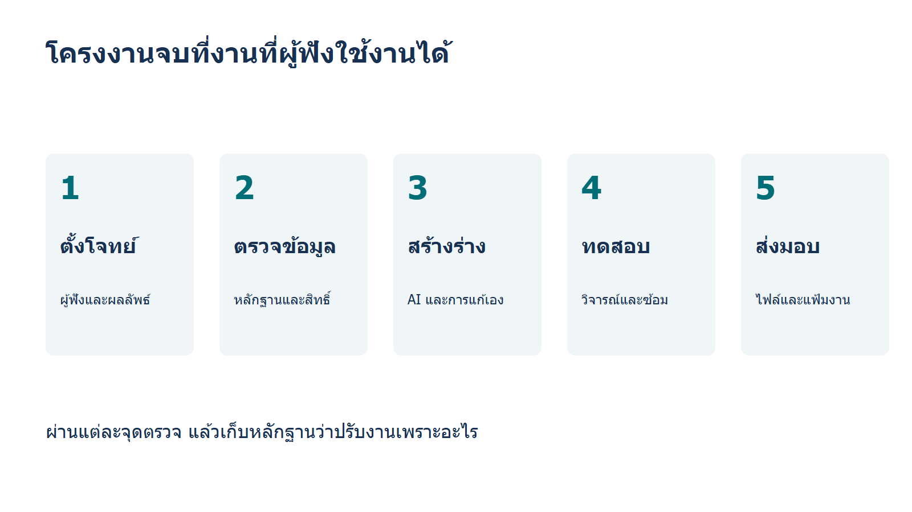

# หน่วยที่ 6 · โครงงานนำเสนอด้วย AI และแฟ้มสะสมผลงาน

[หน่วยก่อนหน้า](05-media-and-delivery.md) · [หน้าหลัก](../README.md)

เวลาแนะนำ 6 ชั่วโมง · ฉบับ 21 พฤศจิกายน 2569

## เป้าหมายและผลงานปลายหลักสูตร

นำความรู้ทั้ง 5 หน่วยมาออกแบบโครงงานที่มีผู้ฟังและผลลัพธ์ชัด ใช้ AI อย่างมีหลักฐานการตัดสินใจ ตรวจข้อมูลและสื่อ นำเสนอและปรับจากข้อเสนอแนะ แล้วจัดแฟ้มงานที่ผู้สอนเปิดดูได้

**ผลงานหลัก:** งานนำเสนอภาษาไทย **8 หน้า** รวมหน้าแหล่งอ้างอิง พูด **5 นาที** พร้อมต้นฉบับ PDF บันทึกผู้พูด ใบงาน และแฟ้มกระบวนการ ผู้สอนปรับจำนวนหน้า/เวลาตามบริบทได้แต่ต้องแจ้งก่อนเริ่ม ใช้ [ใบงาน 6](../worksheets/06-capstone.md) เป็นแผนติดตาม



## 6.1 เลือกโจทย์ที่ทำได้และมีคนใช้จริง

เลือกเรื่องที่ผู้เรียนเข้าใจและหาแหล่งตรวจได้ เช่น เสนอปรับมุมอ่านหนังสือ แนะนำกิจกรรมชมรม นำเสนอรายงานการเรียนรู้ หรืออธิบายกระบวนการทำงาน อย่าเริ่มจากหัวข้อกว้างจนหาเป้าหมายไม่เจอ

| โจทย์กว้าง | ปรับให้ทำงานได้ |
| --- | --- |
| เทคโนโลยีเปลี่ยนโลก | เสนอเวิร์กช็อปใช้ AI วางโครงสไลด์สำหรับชมรม 1 ครั้ง |
| โรงเรียนที่ดี | เสนอมุมอ่านหนังสือทดลองหนึ่งพื้นที่เป็นเวลา 2 สัปดาห์ |
| การเรียนให้เก่ง | อธิบายวิธีทำบันทึกทบทวนบทเรียนให้เพื่อนในชั้นทดลอง |

เขียน brief 6 ข้อ: ผู้ฟังคือใคร ปัญหาเฉพาะคืออะไร ต้องการให้ตัดสินใจอะไร มีหลักฐานอะไร ขอบเขตเวลาและทรัพยากรเท่าไร และจะรู้ได้อย่างไรว่างานสื่อสารสำเร็จ

**จุดตรวจ 1:** เพื่อนหนึ่งคนอ่าน brief แล้วบอกเป้าหมายได้ตรง ผู้เรียนแก้โจทย์ก่อนสร้างสไลด์ ไม่ใช้จำนวนสไลด์เป็นตัวแทนความสำเร็จ

## 6.2 สร้างบัญชีหลักฐานและสิทธิ์สื่อ

ทำตารางหลักฐานก่อนสั่ง AI เพื่อให้ทุกข้ออ้างย้อนกลับไปดูต้นทางได้

| ข้อความที่จะกล่าว | หลักฐาน | สถานะ | ตำแหน่งใช้งาน |
| --- | --- | --- | --- |
| ข้อเท็จจริงจากบทความ/รายงาน | URL ชื่อผู้จัดทำ วันที่ และส่วนที่รองรับ | ตรวจแล้ว/รอตรวจ | หน้าใด |
| จำนวนที่เก็บเอง | วิธีเก็บ ช่วงเวลา หน่วย และข้อจำกัด | ข้อมูลจริง | หน้าใด |
| สมมติงบหรือผลเพื่อฝึก | ระบุว่าตั้งขึ้น ไม่มีการเก็บหรือเสนอราคาจริง | สมมติ | หน้าใด |
| ภาพหรือไอคอน | ผู้สร้าง แหล่ง สิทธิ์ และการดัดแปลง | ใช้ได้ตามเงื่อนไข | หน้าใด |

เปิดแหล่งอ้างอิงจริงก่อนใส่ลงสไลด์ ถ้าข้อมูลยังตรวจไม่ได้ให้ตัดข้ออ้าง ลดความหนักแน่น หรือเก็บเป็นคำถามที่ต้องหาต่อ ตัวเลขประมาณการต้องมีวิธีตั้งสมมติฐานและป้ายแยกจากผลจริง

ใช้ข้อมูลที่ไม่ระบุตัวบุคคลเมื่อไม่จำเป็น ถ้าศึกษาในชั้นเรียนให้ทำตามแนวทางผู้สอนและสถานศึกษา บันทึกแหล่งสื่อตาม [แบบส่งงาน](../worksheets/submission-template.md)

**จุดตรวจ 2:** ข้อความสำคัญทุกข้อมีหลักฐานหรือระบุสมมติ ภาพมีสิทธิ์ใช้ และยังไม่สรุปเกินข้อมูล

## 6.3 วางสตอรีบอร์ด 8 หน้า

| หน้า | หน้าที่ | คำถามที่ต้องตอบ |
| --- | --- | --- |
| 1 ปกและเป้าหมาย | เปิดประเด็น | นำเสนอเรื่องอะไร ให้ใคร และอยากให้ทำอะไร |
| 2 ปัญหา | เชื่อมกับผู้ฟัง | เกิดอะไรขึ้น สำคัญอย่างไร และขอบเขตเท่าไร |
| 3 หลักฐาน | ทำให้ตรวจเหตุผลได้ | ข้อมูลใดรองรับ อะไรยังไม่รู้ |
| 4 แนวทาง | เสนอสิ่งที่จะทำ | จะแก้/อธิบาย/จัดกิจกรรมอย่างไร |
| 5 แผนดำเนินการ | ทำให้เป็นไปได้ | ใคร ทำอะไร เมื่อไร และใช้ทรัพยากรใด |
| 6 ข้อจำกัดและทางเลือก | ช่วยตัดสินใจ | อะไรอาจติดขัด มีวิธีสำรองอย่างไร |
| 7 ข้อสรุปและคำขอ | จบที่ผลลัพธ์ | ขอให้ผู้ฟังตัดสินใจหรือเริ่มทำอะไร |
| 8 แหล่งอ้างอิงและสื่อ | เปิดให้ตรวจต่อ | ข้อมูลและสื่อมาจากไหน ส่วนใดใช้ AI |

งานวิชาการปรับหน้า 4–6 เป็นวิธีการ ผล และข้อจำกัดได้ โดยคงการเชื่อมคำถามกับข้อสรุป หน้าที่ 8 ใช้อ้างอิงรายละเอียดเพิ่มเติม ที่มาสั้นของกราฟยังควรอยู่ใกล้กราฟในหน้าที่ใช้งาน

เขียนหัวข้อและสารของทั้ง 8 หน้าให้ครบก่อนใช้ Gamma เมื่อเห็นหน้าที่ซ้ำกันให้รวมและจัดใหม่ ไม่เพิ่มหน้าเพียงเพื่อให้ดูเหมือนมีเนื้อหาเยอะ

## 6.4 ใช้ AI สร้างร่างและคุมขอบเขต

ใช้ prompt นี้กับเนื้อหาที่ตรวจแล้ว เติมทุกช่องที่เป็นข้อมูลของตนก่อนส่ง

```text
ช่วยออกแบบ Presentation ภาษาไทย 8 หน้า รวมหน้าอ้างอิง
ผู้ฟัง: [ระบุ] เป้าหมาย: [ระบุการตัดสินใจหรือการลงมือ]
เวลาพูด 5 นาที โทน: [ระบุ] ระบบสี: [ระบุ]

ใช้สตอรีบอร์ดและข้อมูลที่แนบเท่านั้น
เสนอแผนและชื่อหัวข้อทั้ง 8 หน้าให้ตรวจ ก่อนสร้าง
แยกข้อมูลจริง สมมติฐาน และข้อเสนออย่างชัดเจน
ไม่แต่งชื่อหน่วยงาน สถิติ ผลวิจัย ราคา หรือ URL
ใช้ข้อความที่แก้ได้ แผนภาพ/กราฟที่มีป้ายค่าและหน่วย
เก็บที่มาสั้นใกล้ข้อมูล และรายละเอียดแหล่งในหน้าสุดท้าย
หากข้อมูลไม่พอให้ทำรายการคำถาม แทนเติมคำตอบเอง

[วาง brief สตอรีบอร์ด และบัญชีหลักฐานที่ตรวจแล้ว]
```

ใช้ Plan หรือ Paste ตามหน่วย 2 ตรวจว่าการสร้าง 8 หน้าอยู่ในสิทธิ์และเครดิตที่บัญชีมี หากเครดิตไม่พอให้ทำโครงเดิมต่อด้วยมือหรือเครื่องมือที่เข้าถึงได้ การประเมินวัดผลงานและการตัดสินใจ ไม่วัดการซื้อบริการ

**จุดตรวจ 3:** ร่างครบ 8 หน้า ข้อความไทยครบ ค่าสำคัญตรงต้นฉบับ และมีรายการสิ่งที่ต้องแก้ ไม่ถือร่างแรกเป็นฉบับส่ง

## 6.5 ตัวอย่างโครงงานครบ: มุมอ่านหนังสือทดลอง

ตัวอย่างต่อไปนี้เป็น **โครงงานสมมติทั้งชุด** ไม่มีการสำรวจ ขออนุมัติ หรือจัดซื้อจริง งบตั้งขึ้นเพื่อฝึกคำนวณ ไม่ใช่ราคาตลาด เปิด [ข้อความ 8 หน้าสำหรับฝึก](../examples/prompts/unit-06-capstone.txt) แล้วเลือกธีมตามผู้ฟัง

| หน้า | สารและเนื้อหาตัวอย่าง | การออกแบบ/การตรวจ |
| --- | --- | --- |
| 1 | เสนอมุมอ่านหนังสือทดลอง 2 สัปดาห์ ต่อคณะทำงานกิจกรรม | ปกระบุผู้จัดทำและสมมติ |
| 2 | ต้องการพื้นที่อ่านที่หยิบหนังสือและนั่งได้สะดวก | ใช้แผนภาพความต้องการ ไม่แสดงเป็นผลสำรวจจริง |
| 3 | สมมติแบบสอบถาม 20 คน มี 14 คนเลือกว่าต้องการพื้นที่อ่านสงบ | กราฟ 14/20 = 70% ระบุคำถาม กลุ่มสมมติ และยังไม่แทนทั้งโรงเรียน |
| 4 | เสนอจัด 1 มุม พร้อมหนังสือและกติกาใช้ร่วมกัน | แผนภาพพื้นที่แนวคิด ไม่ใช่แบบก่อสร้าง |
| 5 | เตรียมพื้นที่ ทดลอง 2 สัปดาห์ แล้วทบทวน งบสมมติ 4,000 บาท | ตารางหนังสือ 2,000 ชั้น/จัดวาง 1,500 ป้าย/วัสดุ 500 รวมถูก |
| 6 | ข้อจำกัดเรื่องพื้นที่ งบ และการใช้ร่วมกัน | มีทางเลือกใช้ทรัพยากรเดิมและเก็บความเห็นจริง |
| 7 | ขอเห็นชอบให้สำรวจพื้นที่และเก็บข้อมูลจริงก่อนดำเนินการ | แยกคำขอจากการอนุมัติที่ยังไม่เกิดขึ้น |
| 8 | ที่มา: ข้อมูลสมมติของหลักสูตร ภาพตามสิทธิ์ และบันทึกใช้ AI | ไม่สร้างบรรณานุกรมปลอมเพื่อให้ดูวิชาการ |

ข้อมูลสมมติ 14 จาก 20 คิดเป็น 70% ของกลุ่มที่ตั้งขึ้น ไม่ใช่ 70% ของนักเรียนทั้งโรงเรียน ในหน้าที่มีราคาให้ใส่ “งบสมมติเพื่อฝึก ไม่ใช่ใบเสนอราคา” หากนำไปใช้จริงต้องสำรวจและหาราคาที่ตรวจได้ใหม่

**งานของผู้เรียน:** เปลี่ยนโจทย์เป็นเรื่องของตน ใช้ตัวอย่างเป็นโครงเท่านั้น หากยังไม่มีข้อมูลจริงให้ใช้โหมดสถานการณ์สมมติและประกาศทุกส่วนที่เกี่ยวข้อง ผู้สอนสามารถกำหนดให้งานปลายหลักสูตรใช้ข้อมูลจริงเป็นเกณฑ์เพิ่มเติมก่อนเริ่ม

## 6.6 ทดสอบและแก้ด้วยเหตุผล

ใช้การทดสอบ 3 แบบ: ให้คนดู 5 วินาทีแล้วบอกสาร ให้คนอ่านกราฟแล้วตอบค่าหลัก และให้คนฟังจนจบแล้วบอกสิ่งที่ต้องทำต่อ บันทึกคำตอบตามจริงเพื่อชี้ว่าแบบร่างสื่อสารถึงหรือยัง

| สิ่งที่พบ | การแก้ที่มีเหตุผล | หลักฐานหลังแก้ |
| --- | --- | --- |
| ผู้ฟังไม่รู้ว่าขออนุมัติอะไร | เปลี่ยนชื่อหน้าสรุปเป็นคำขอเฉพาะ | ผู้ฟังบอกคำขอได้ตรง |
| ตัวเลขไม่มีฐาน | เพิ่ม 14 จาก 20 และสถานะสมมติใกล้กราฟ | ผู้ฟังระบุฐานและข้อจำกัดได้ |
| เนื้อหาล้นและพูดเกินเวลา | ย่อความซ้ำ ย้ายรายละเอียดไปโน้ต | ไฟล์อ่านชัดและซ้อมภายในเวลา |

เก็บภาพก่อน–หลังอย่างน้อย 1 คู่ พร้อมเหตุผลแก้ 3 จุด ตรวจไฟล์หลังส่งออกตามหน่วย 5 อีกครั้ง **จุดตรวจ 4:** ผู้อื่นเข้าใจสารหลัก ตัวเลข และสิ่งที่ให้ทำต่อได้

## 6.7 นำเสนอและประเมิน

นำเสนอ 5 นาทีแล้วตอบคำถาม 3 นาทีต่อคน/กลุ่ม หากมีหลายกลุ่ม ผู้สอนจัดสถานีหรือแยกช่วงให้ทุกกลุ่มมีเวลาเท่ากัน ใช้ [เกณฑ์ 100 คะแนน](../worksheets/assessment.md) ผ่าน 70 คะแนน และแก้ข้อมูลสำคัญผิด แหล่งปลอม หรือไฟล์เปิดไม่ได้ก่อนรับฉบับสมบูรณ์

การใช้ AI ต้องมีหลักฐาน prompt และการตัดสินใจของผู้เรียน การทำเองเพิ่มเติมหรือการแก้ข้อผิดพลาดเป็นส่วนหนึ่งของผลงาน ทุกคนอธิบายสาร ข้อมูล และเหตุผลที่เลือกเลย์เอาต์ได้

## 6.8 จัดแฟ้มสะสมผลงาน

จัดไฟล์ตามโครงนี้ ชื่อเป็นตัวอย่าง ผู้เรียนเปลี่ยนให้ตรงงานได้

```text
portfolio/
  README.md                 ภาพรวม เป้าหมาย และลิงก์ผลงาน
  final-presentation.pdf    ฉบับที่เปิดตรวจแล้ว 8 หน้า
  source-link.txt           URL ต้นฉบับหรือที่อยู่ไฟล์แก้ไขได้
  speaker-notes.md          บันทึกผู้พูด
  evidence-and-media.md     แหล่งข้อมูลและเครดิตสื่อ
  ai-process.md             prompt และเหตุผลการแก้
  before-after/             ภาพเปรียบเทียบอย่างน้อย 1 คู่
  reflection.md             บทเรียนจากการทำงานและสิ่งที่จะปรับ
```

ใช้ [แม่แบบแฟ้มงาน](../worksheets/portfolio-template.md) และ [แบบส่งงาน](../worksheets/submission-template.md) ตั้งสิทธิ์ให้ผู้สอนดูได้ตามช่องทางที่ชั้นเรียนกำหนด การทำแฟ้มไม่จำเป็นต้องเผยแพร่สาธารณะ

**จุดตรวจ 5:** เปิดทุกไฟล์และลิงก์จากตำแหน่งส่งจริง ค้นได้ว่าฉบับไหนเป็นฉบับสุดท้าย หลักฐานตรงกับเนื้อหาปัจจุบัน และมีบันทึกการเรียนรู้ของตน

## 6.9 แผนทำงาน 6 ชั่วโมง

| ช่วง | นาที | ผลงานก่อนเดินต่อ |
| --- | ---: | --- |
| ตั้งโจทย์และตรวจ brief | 30 | จุดตรวจ 1 |
| ค้น/ตรวจข้อมูลและสิทธิ์ | 60 | จุดตรวจ 2 |
| สตอรีบอร์ดและร่างด้วย AI | 90 | จุดตรวจ 3 |
| ทดสอบ วิจารณ์ และปรับ | 60 | จุดตรวจ 4 |
| นำเสนอและตอบคำถาม | 90 | คะแนนและข้อเสนอแนะ ปรับตามจำนวนกลุ่ม |
| จัดแฟ้มและสะท้อนผล | 30 | จุดตรวจ 5 |
| **รวม** | **360** | **6 ชั่วโมง** |

ช่วงนำเสนอ 90 นาทีรองรับเวลาพูดและถามตอบ 8 นาทีได้ประมาณ 10 กลุ่มเมื่อเผื่อเปลี่ยนกลุ่มเล็กน้อย ถ้ามีมากกว่านี้ให้เพิ่มเวลา/จัดสถานี ไม่ลดเวลาทีละกลุ่มโดยไม่แจ้ง

## คำถามสรุปหลักสูตร

1. อะไรควรมาก่อนการเลือกเทมเพลต?
2. จะพิสูจน์ได้อย่างไรว่า AI ไม่ได้เพิ่มตัวเลขที่ไม่มีในต้นฉบับ?
3. ทำไมแหล่งอ้างอิงท้ายชุดยังไม่แทนที่มาสั้นใกล้กราฟ?
4. ภาพก่อน–หลังควรแสดงเพียงความสวยที่เพิ่มขึ้นหรืออะไรอีก?
5. จะทำอย่างไรให้ผลงานพร้อมใช้แม้อินเทอร์เน็ตขัดข้อง?

<details>
<summary>แนวคำตอบ</summary>

1. ผู้ฟัง เป้าหมาย สารหลัก และหลักฐาน
2. เทียบทีละข้อกับบัญชีหลักฐาน ตรวจสูตร และเปิดแหล่งต้นทางจริง
3. ผู้ฟังต้องรู้ฐานและที่มาขณะตีความกราฟ หน้าอ้างอิงใช้ดูรายละเอียดต่อ
4. แสดงปัญหาการสื่อสาร เหตุผลตัดสินใจ และผลทดสอบหลังแก้
5. เตรียม PDF โน้ต ภาพนิ่งแทนคลิป และทดสอบเปิดจากไฟล์ที่จะใช้จริง

</details>

[ทำใบงานโครงงาน](../worksheets/06-capstone.md) · [แม่แบบแฟ้มงาน](../worksheets/portfolio-template.md) · [กลับภาพรวมหลักสูตร](../README.md)
